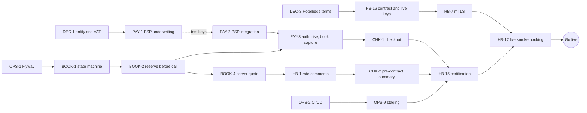

# Ship Bodiala to EU hotel shoppers safely

**Bodiala works as a Hotelbeds integration, but it is shaped like a B2B agent console, not a consumer business.** Any anonymous visitor can create a real Hotelbeds booking that the agency is invoiced for without paying a cent, list every booking in the database, and cancel anyone's booking by guessing its supplier reference. The code also never compares the price quoted with the price confirmed, and it shows customers the net trade price. Turning it into a public website that sells to EU consumers takes **123 backlog tasks across 13 epics**. **87 of them are launch blockers (P0)**, because three independent gates each set a high floor. The first is **Hotelbeds certification**: rate comments, a voucher with mandatory fields, child ages, GZIP, CheckRate discipline, source-market rules, weekly content refresh and production mTLS. The second is **EU consumer, privacy and accessibility law**: all-in pricing, pre-contract information, GDPR, cookies and the European Accessibility Act. The third is **money safety**: authorise, then book, then capture, plus reconciliation of unknown outcomes and refunds. The longest lead times are not code. Choosing the operating entity and VAT scheme, passing a PSP's restricted-business review for travel, and signing the Hotelbeds contract and getting certified (8–12 weeks by one [UNVERIFIED] vendor estimate) should all start this week, alongside the security fixes. The recommended path has six parts:

- an EU entity in Spain or Portugal under the travel-agent margin scheme (TOMS);
- merchant-of-record sales of prepaid AT_WEB net rates with our own markup;
- Stripe as the first PSP, with Adyen quoted in parallel;
- guest checkout, with magic-link booking management;
- server-rendered public pages;
- a staged launch: close the security holes, make booking correct, take payments, certify, then grow.

---

## How to use this document

This file is meant to be copied to `docs/backlog.md`, with each task created as a Jira issue.

- **Mapping to Jira.** Each epic below becomes a Jira Epic. Each task becomes a Story or Task whose summary starts with its ID. Turn "Depends on" into "is blocked by" links, and paste the acceptance criteria as a checklist. The decisions (`DEC-n`) are Jira tasks too, owned by the founders. Many engineering tasks are blocked by them.
- **IDs are stable.** Never renumber. Add new tasks at the end of an epic.
- **Priority:**
  - **P0:** launch blocker (legal, money, privacy or certification exposure).
  - **P1:** needed soon after launch.
  - **P2:** important.
  - **P3:** nice to have.
- **Type:** engineering, business, legal or ops. Mixed tasks list both, lead discipline first.
- **Effort:** synthesiser estimates, not sourced figures. **S** is up to about 3 person-days, **M** about 1–2 person-weeks, and **L** 3 or more person-weeks.
- **Repos:** `bodiala` (backend), `bodiala-web` (frontend), `hotelbeds-stub` (fake API).
- **Code citations** use bare file names with line numbers, as audited at bodiala HEAD `985d946` and bodiala-web HEAD `d0ef010`. File names are unique across the three repos, except `CLAUDE.md` and `application.properties`, which are qualified where they appear.
- **Tags:**
  - **[UNVERIFIED]:** rests on a search snippet, a third party or an unconfirmed field.
  - **[OLD]:** a source from before 2023 that is still the reference point.
  - **[LAWYER]:** counsel must confirm.

---

## Executive summary: a working integration with every door open

**Where the product stands.** Against the stub, the full chain works: signed client, aggregated availability search, CheckRate, prebook, book and cancel, catalog sync, on-demand hotel content and facility names. Catalog import, live availability, hotel detail and amenities have also been confirmed against the real Hotelbeds test API (bodiala `CLAUDE.md`). The frontend drives search, detail, book, bookings and cancel. The code is readable, and some patterns are worth keeping: URL-as-state, per-tab result caching and stale-response protection. Everything around that happy path, though, assumes a trusted agent at a laptop:

- There is no Spring Security dependency (`build.gradle:21-42`).
- The checkout has no payment step (`BookHotelDialog.tsx:20`).
- The schema is managed by `ddl-auto=update` with no migrations (`application.properties:25`).
- There is no CI, container image, health check or backup.
- The booking money path has **zero tests**. The 82 backend tests are mostly mappers and registries. The frontend has none.

The stub always answers CONFIRMED and cannot produce the failures that cost money (`StubController.java:27-29`, `489-495`). "Verified against the stub" therefore says nothing about money safety.

**The biggest risks**, each traced to evidence and to the tasks that remove it:

| # | Risk | Evidence | Removed by |
|---|---|---|---|
| 1 | **Free real bookings and open booking data.** Anyone can book on the agency's credit, list all bookings and cancel any booking. | no security layer at all (`build.gradle:21-42`); list, read and cancel are open (`BookingController.java:62-79`); "Confirm" posts straight to a Hotelbeds booking with no payment (`BookHotelDialog.tsx:115-140`; `HotelbedsBookingProvider.java:104-112`); supplier refs look like `1-4075658` and the stub issues them sequentially (`api-contract.md:38`; `StubBookingStore.java:30-37`) | SEC-1, SEC-2, PAY-2, PAY-3 |
| 2 | **Money leaks and orphan bookings.** Idempotency never runs, a timeout or persist failure leaves an untracked booking, Hotelbeds may confirm 2% above the quote, and net cost is shown and stored as the customer price. | `HotelbedsBookingProvider.java:92-101`, `110`, `133`, `136-142`; `BookHotelDialog.tsx:115-131` | BOOK-1 … BOOK-9, PAY-3, PAY-6 |
| 3 | **Certification failure.** No rate comments, no voucher, no child ages, no GZIP, CheckRate on every rate in one batch, destination sent as nationality, 100-hotel catalog with no weekly refresh, no mTLS. | `CheckRateResponse.java:20-23`; `BookingResponse.java:12-26`; `searchState.ts:97-106`; `HotelbedsJsonClient.java:27`, `40-46`; `HotelbedsBookingProvider.java:65-77` ([Certification process](https://developer.hotelbeds.com/documentation/hotels/knowledge-base/certification-process/)) | HB-1 … HB-17 |
| 4 | **Wrong legal and commercial structure.** A non-EU operator may lose the travel-agent margin scheme and owe full VAT in each hotel country. Stripe treats travel reservations as a restricted business. Hotelbeds disconnects partners that leak opaque rates. | German BMF letter excluding third-country operators from TOMS ([FGS](https://fgs.de/news-and-insights/blog/detail/federal-ministry-of-finance-locks-third-country-taxable-persons-out-of-applying-the-toms-regime-special-regulation-for-travel-agents-in-acc-with-art-306-eu-vat-directive)) [OLD]; [Stripe restricted businesses](https://stripe.com/legal/restricted-businesses); three-strike rate-integrity policy ([Travelmole](https://travelmole.com/news/hotelbeds-outlines-commitment-to-rate-integrity)) [OLD] | DEC-1 … DEC-4, HB-5, HB-16 |
| 5 | **Regulatory exposure on the page itself.** No all-in total, no pre-contract information, structural accessibility failures, and Google Fonts loaded without consent. | EU CPC commitments on total price ([European Commission](https://commission.europa.eu/topics/consumers/consumer-rights-and-complaints/enforcement-consumer-protection/coordinated-actions/accommodation-booking_en)); EAA court order against Carrefour, 4 June 2026 ([AccessiWay](https://www.accessiway.com/blog/eaa-enforcement)); LG München I Google Fonts ruling ([court text](https://www.gesetze-bayern.de/Content/Document/Y-300-Z-GRURRS-B-2022-N-612?view=Print)); `styles.css:1` | SRCH-2, CHK-2, A11Y-1 … A11Y-7, LEGAL-1 … LEGAL-9 |
| 6 | **Supplier quota burn and credential-block risk.** Anonymous callers and crawlers can trigger unlimited live Content-API and availability calls. | `HotelCoverService.java:53-76`; `SearchView.tsx:191-236`; the team's own plan forbids real-time content polling (`multi-provider-plan.md:301-302`) | SEC-3, SEC-4, SEO-1 |

**Why so many P0s.** The 87 P0 tasks split into 25 S, 53 M and 9 L. Most are mandated, not chosen:

- Hotelbeds' certification checklist accounts for all 17 HB tasks.
- EU consumer, privacy and accessibility law drives most of the LEGAL, A11Y and CHK tasks.
- Money safety drives BOOK and PAY.

Under that floor, the sequence matters more than the list. Until Phase 3 (payments) is done, **the booking endpoints must not be reachable by the public at all**. The Phase 1 fixes make the codebase safe to keep developing; they do not make it safe to sell.

| Priority | Tasks | Meaning |
|---|---|---|
| P0 | 87 | Launch blocker |
| P1 | 23 | Soon after launch |
| P2 | 10 | Important |
| P3 | 3 | Nice to have |

---

## Decisions to make first: nine choices that gate the engineering

These decisions decide what gets built. Several of them (entity, PSP, Hotelbeds contract) also have the longest calendar lead times in the whole plan. Each one lists its options, a recommendation from the research, the tasks it gates, and the people who must be consulted. Record every outcome in `docs/decisions/` and link it from the Jira task.

### DEC-1 · Choose the operating entity's jurisdiction and VAT scheme

**Type:** business, legal, tax. **Gates:** PAY-1, PAY-7, LEGAL-1, LEGAL-2, LEGAL-3, LEGAL-8, LEGAL-11, LEGAL-13, LEGAL-14, HB-16.

The EU special scheme for travel agents (TOMS, Arts. 306–310 of the VAT Directive) applies to agents dealing with customers **in their own name**. It does not apply to pure intermediaries ([Art. 306](https://www.legislation.gov.uk/eudr/2006/112/article/306)). The single service is taxed **where the agent is established**, with VAT charged on the margin ([Art. 307](https://www.legislation.gov.uk/eudr/2006/112/article/307)). The CJEU confirmed in C-108/22 that the scheme covers plain resale of accommodation ([PwC Austria](https://steuernachrichten.pwc.at/en/blog/2023/08/22/cjeu-special-vat-scheme-applicable-to-travel-agents-also-in-case-of-mere-resale-of-accommodation-services)).

A non-EU operator has no EU establishment for Art. 307 to attach to, and the Member States disagree on what follows. Germany's finance ministry held in 2021 that third-country businesses cannot use the scheme ([FGS](https://fgs.de/news-and-insights/blog/detail/federal-ministry-of-finance-locks-third-country-taxable-persons-out-of-applying-the-toms-regime-special-regulation-for-travel-agents-in-acc-with-art-306-eu-vat-directive)) [OLD]. A Lower Saxony court disagreed in interim proceedings ([ETOA copy](https://www.etoa.org/wp-content/uploads/2023/01/230120-Google-Translate-FG-NDS-Beschl-2022-11-17-5-V-96-22-USt-NonEU-RV-in-TOMS.pdf)) [OLD]. The EU VAT Committee still lists the question as open ([WP 814](https://www.vatupdate.com/wp-content/uploads/2022/05/WP-814-Online-supplies-made-by-a-travel-agent-to-final-consumers-1.pdf)).

A non-EU entity has further costs:

- It needs a GDPR Art. 27 representative and gets no one-stop-shop ([GDPR](https://eur-lex.europa.eu/eli/reg/2016/679/oj)).
- Georgia, the notes' working example, has no adequacy decision ([European Commission](https://commission.europa.eu/law/law-topic/data-protection/international-dimension-data-protection/adequacy-decisions_en)).
- Stripe is likely unavailable to a Georgian company [UNVERIFIED].
- A non-EU acquirer makes payments "one-leg-out". That is outside SCA, but EEA issuers may still decline them ([Stripe SCA guide](https://stripe.com/guides/strong-customer-authentication)).

| Option | For | Against |
|---|---|---|
| **A. EU entity in Spain or Portugal** (where the inventory is) | TOMS margin VAT in one state; lead DPA (one-stop-shop); easiest PSP onboarding; local ADR and licensing clarity | Local incorporation and accounting cost; regional travel-agency registration may apply (LEGAL-14) |
| B. EU entity in another Member State | Same TOMS and GDPR benefits | Still faces ES/PT licensing questions; no inventory proximity |
| C. Non-EU entity (e.g. Georgia) selling directly | No new incorporation | Possible loss of TOMS, meaning full VAT on the gross sale with registration in each hotel country; Art. 27 representative; Chapter V transfer tools; harder PSP onboarding; weaker SCA approval rates |

**Recommendation: A**, subject to written advice from a Spanish or Portuguese VAT adviser **before incorporating**. The advice should cover four points: TOMS for accommodation-only resale after C-108/22, how a non-EU parent is treated, the invoice format, and whether Hotelbeds' own invoices to us fall under the margin scheme.

### DEC-2 · Choose the contracting and merchant model

**Type:** business, legal. **Gates:** HB-5, PAY-1 … PAY-8, LEGAL-2, CHK-2.

Under the merchant model the distributor collects payment and pays the supplier an agreed net amount. Under the agency model the hotel remains the seller of record ([AltexSoft glossary](https://www.altexsoft.com/glossary/merchant-model/)). Hotelbeds rates carry a `paymentType`: `AT_WEB` in the workflow examples, and `AT_HOTEL` on a commissionable example rate ([Pricing models](https://developer.hotelbeds.com/documentation/hotels/knowledge-base/pricing-models/)). Our own docs disagree on when Hotelbeds needs the guest's card in `paymentData`. `api-contract.md` says AT_HOTEL and credit-card accounts. `multi-provider-plan.md` says "card-required" AT_WEB rates.

| Option | For | Against |
|---|---|---|
| **A. Merchant of record, selling prepaid AT_WEB rates in our own name** | We control the margin; TOMS applies (DEC-1); card data stays at the PSP (PCI SAQ A) | We carry chargeback, refund and fraud risk; the PSP may hold a reserve; customer cash is a liability until stays complete |
| B. Disclosed agent (hotel or Hotelbeds is the seller; we earn commission) | Lower payment risk | Outside TOMS (Art. 306 excludes intermediaries); less control of price and experience; depends on Hotelbeds offering it |
| C. Pay at hotel (AT_HOTEL, commissionable) | No PSP needed at launch | Sell price fixed by Hotelbeds; commission paid later; may require passing the guest's raw card via `paymentData`, which puts us in PCI SAQ D |

**Recommendation: A.** Sell only AT_WEB net rates at launch. Filter AT_HOTEL rates out with `filter.paymentType` (HB-5) unless Hotelbeds confirms in writing that no guest card passes through us. Counsel confirms that the T&Cs and checkout wording present us as principal (LEGAL-2).

### DEC-3 · Agree the Hotelbeds commercial terms that code depends on

**Type:** business. **Gates:** BOOK-3, HB-5, HB-16, CHK-6, SEO-9, GROW-4.

Hotelbeds sets the pricing model (net or commissionable) and currency per contract through the HBX Group sales manager ([Pricing models](https://developer.hotelbeds.com/documentation/hotels/knowledge-base/pricing-models/)). Third parties report that production access follows a signed commercial agreement ([Vervotech](https://www.vervotech.com/hub/integrations/apitude-api/)). Hotelbeds polices "rate integrity" with a dedicated team and a three-strike disconnection policy for partners leaking opaque rates ([Travelmole](https://travelmole.com/news/hotelbeds-outlines-commitment-to-rate-integrity)) [OLD, 2019]. On the supply side, Hotelbeds settles with hotels 30–45 days after check-out ([NightsBridge](https://nightsbridge.screenstepslive.com/a/1614932-hotelbeds-payments)) [second-hand]. Its terms for clients like us are not public.

| Option | For | Against |
|---|---|---|
| **A. Net model, EUR settlement, our own markup** (respecting `sellingRate` whenever `hotelMandatory=true`) | Margin under our control; one currency for ES/PT inventory | We must build the markup engine and the mandatory-rate floor (BOOK-3) |
| B. Commissionable model (`sellingRate` is final) | No markup engine | Margin fixed by Hotelbeds; commission arrives later |

**Recommendation: A.** In the same negotiation, get these in writing:

- how we pay Hotelbeds (credit line, deposit or prepayment) and whether a guarantee is required;
- whether `paymentData` is ever required for our account;
- which rates may be sold **standalone to consumers**, and whether any `packaging=true` or opaque rates will be returned;
- any parity or minimum-price rules beyond `hotelMandatory`;
- activation of the tax breakdown;
- production quota and QPS;
- whether consumers may see the Hotelbeds or HBX name;
- the rules for caching or proxying images from `photos.hotelbeds.com`.

### DEC-4 · Choose the PSP and the payment methods for launch

**Type:** business. **Gates:** PAY-1 … PAY-12, SEC-7.

| Option | For | Against |
|---|---|---|
| **A. Stripe first** | Self-serve integration; Payment Element keeps us in SAQ A; Radar fraud tools; Bizum and MB WAY available | "Travel reservation services and clubs" is a **restricted** category that needs extra due diligence, with approval not guaranteed (list updated 2026-09-22) ([Stripe](https://stripe.com/legal/restricted-businesses)); an undated FAQ says Stripe does not support them without explicit prior approval ([Stripe FAQ](https://support.stripe.com/questions/prohibited-and-restricted-businesses-faqs)); possible reserve (5–10% for 30–180 days cited by a blog [UNVERIFIED]); extended authorisation needs IC+ pricing ([Stripe](https://docs.stripe.com/payments/extended-authorization.md?platform=web&ui=elements)) |
| B. Adyen | IC++ pricing (+0.60% + $0.13 on cards); no setup or monthly fees ([Adyen pricing](https://www.adyen.com/pricing)) | Minimum invoice depends on industry; reported as selective with small travel merchants (competitor sources, low confidence) |
| C. Checkout.com, Mollie or a travel-specialist acquirer | Possibly more travel-friendly | **Not researched** |

**Recommendation: A, with B quoted in parallel.**

- Describe the model honestly in the application: prepaid hotel resale, typical booking-to-stay lead time, refund policy.
- Build behind a `PaymentProvider` interface (PAY-2) so the PSP can be swapped.
- Launch with cards plus Apple Pay and Google Pay.
- Defer Bizum and MB WAY (PAY-11): neither supports manual capture, and MB WAY's default user daily limit is €1,000 ([Stripe MB WAY](https://docs.stripe.com/payments/mb-way)).

### DEC-5 · Set the pricing, tolerance and refund policy

**Type:** business. **Gates:** BOOK-3, BOOK-5, PAY-5, LEGAL-2.

Every booking is currently sent with `tolerance: 2` (`HotelbedsBookingProvider.java:110`). The tolerance is a percentage (`api-contract.md:36`), and one community source reads it as the allowed price increase before re-confirmation is required [UNVERIFIED] ([Glama](https://glama.ai/mcp/servers/karanrao/hotelbeds-mcp-server)). Once the guest has paid a fixed amount, any confirmed increase comes straight out of the margin.

**Recommendation:**

- **Markup:** sell = max(net × (1 + markup) + fixed fee, `sellingRate` whenever it is present), configurable by destination, star rating and rate class.
- **Tolerance:** 0 at launch, or a budgeted value below the minimum markup.
- **Price increases** seen at CheckRate always go back to the guest for explicit acceptance.
- **Price decreases** are honoured.
- **Cancellation:** a pass-through policy. The guest pays exactly the supplier's penalty for that date, with no admin fee at launch.
- **Currency:** EUR only.

### DEC-6 · Decide how the Hotelbeds source market maps to visitors

**Type:** business, legal. **Gates:** HB-4, SEO-6, I18N-1.

Certification 3.6 says prices obtained for one source market may only be shown for that market ([Certification process](https://developer.hotelbeds.com/documentation/hotels/knowledge-base/certification-process/)). The Geo-blocking Regulation forbids different general conditions of access to hotel accommodation based on nationality or residence (Art. 4(1)(b)). Art. 4(2) still allows differing, non-discriminatory conditions across Member States ([Reg. 2018/302](https://eur-lex.europa.eu/eli/reg/2018/302/oj)). Today the code sends one global, empty-by-default `sourceMarket` (`HotelbedsProperties.java:29`), and the frontend sends the *destination* country as `guestNationality` (`searchState.ts:103`).

| Option | For | Against |
|---|---|---|
| **A. One EU-wide source market for all visitors** | Simplest; no discrimination question | Needs Hotelbeds to confirm one market code is valid for every EU visitor |
| B. Market storefronts the visitor chooses freely (geo-IP may suggest one, never force it), each with its own `sourceMarket` and price cache | Matches cert 3.6 closely | More cache keys and testing; [LAWYER] confirms Art. 4(2) |
| C. Per-visitor residence or nationality driving the price | Precise | Collides with Geo-blocking Art. 4(1)(b); also fails data minimisation |

**Recommendation: A** if Hotelbeds accepts it, otherwise **B**. Never C. Drop `guestNationality` in every case.

### DEC-7 · Fix the launch scope

**Type:** business. **Gates:** I18N-1 … I18N-3, HB-11, SEO-3, LEGAL-6, GROW-4.

**Recommendation:**

- **Market and currency:** EU consumers, EUR.
- **Destinations:** the Spain and Portugal destinations first. The stub catalog also holds AYT (Türkiye) and LON (UK).
- **Languages:** English plus Spanish, with Portuguese next. If Spanish consumers are targeted, translating legal pages and emails (I18N-3) may itself become a P0, depending on mandatory-language rules [LAWYER].
- **Product:** hotel only. No flights, cars, transfers or "package" wording. A hotel-only booking is not a package under Directive 2015/2302 ([PTD](https://eur-lex.europa.eu/eli/dir/2015/2302/oj)), but cross-selling can create one, and the revised Directive 2026/1024 applies a 24-hour data-passing test from 29 March 2029 ([Garrigues](https://blogturismo.garrigues.com/en/european-union/the-european-union-discontinues-linked-travel-arrangements-and-reorganizes-the-legal-framework-governing-package-travel)).
- **Reviews:** no user-generated reviews, which keeps us out of the DSA hosting duties ([DSA](https://eur-lex.europa.eu/eli/reg/2022/2065/oj)).
- **UK:** out of scope at launch.
- **Accessibility:** build for EAA compliance even if the company qualifies as a microenterprise (fewer than 10 staff and turnover or balance sheet of at most €2m), because the exemption is lost on growth ([EAA](https://eur-lex.europa.eu/legal-content/EN/TXT/?uri=CELEX:32019L0882)).

### DEC-8 · Choose how customers identify themselves

**Type:** business, engineering. **Gates:** SEC-2, CHK-3, CHK-4, GROW-2.

| Option | For | Against |
|---|---|---|
| **A. Guest checkout; booking managed via reference + email and an emailed magic link** | No account wall (18% of shoppers abandon when forced to create an account, per [Baymard](https://baymard.com/lists/cart-abandonment-rate)) | Token handling and enumeration protection needed (SEC-2) |
| B. Mandatory accounts | Simple authorisation model | Conversion loss; more personal data to protect |
| C. Guest first, with an optional account offered on the confirmation page | Best of both ([Baymard](https://baymard.com/blog/current-state-of-checkout-ux)) | Two flows to maintain |

**Recommendation: A at launch, C later** (GROW-2).

### DEC-9 · Choose the hosting target and the frontend rendering architecture

**Type:** engineering, ops. **Gates:** OPS-2, OPS-3, OPS-4, LEGAL-11, SEO-2.

The intended host is unknown. `DotEnvEnvironmentPostProcessor.java:26` mentions "the NAS". The frontend is a client-rendered SPA, and Google recommends server-side rendering, static rendering or hydration, calling dynamic rendering a workaround ([Google](https://developers.google.com/search/docs/crawling-indexing/javascript/dynamic-rendering)). The frontend audit concludes that a B2C relaunch is close to a rewrite of the app shell and checkout. React Router 7 framework mode is the smallest step from today's React Router 7 setup.

**Recommendation:**

- Host on a managed platform in an EU region with managed Postgres and point-in-time recovery (OPS-4). That gives a backed-up system of record and EU data residency (LEGAL-11). The NAS is not suitable for this.
- Adopt **React Router 7 framework mode**: SSR or SSG for public pages, with checkout still client-rendered.
- Decide this **before** CHK-1, so checkout is built only once.

---
## The backlog: 123 tasks in 13 epics

Each task has the same layout. The header line gives priority, type, repos, effort and dependencies. **Why** gives the evidence, **What** the change, and the checklist is the acceptance criteria. Duplicate findings across the six research notes have been merged: backend audit, frontend audit, Hotelbeds go-live, payments, legal, and UX/growth. Where a frontend fix and a backend fix are the same problem (for example the price-change warning), they share one task that lists both repos.

### Epic SEC: Security & access

Close the anonymous paths to real-money bookings, other people's booking data, the admin import and the supplier quota. Do this first, before any other work reaches a public URL.

#### SEC-1 · Add Spring Security and lock down admin routes
`P0` · engineering · bodiala · Effort M · Depends on: none

**Why.** There is no security framework: the only starters are web, data-jpa, validation, springdoc, commons-csv, JAXB and postgresql (`build.gradle:21-42`). The routes that should be protected are open:

- `POST /api/static-data/import` is public (`StaticDataController.java:73-82`). It runs `deleteAllInBatch()` on the catalog tables and then spends Content-API quota re-importing (`HotelbedsCatalogImporter.java:108-114`, `128-151`).
- `GET /api/bookings` returns every row, unauthenticated and unpaged (`BookingController.java:62-66`; `HotelbedsBookingProvider.java:199-202`).

**What.** Add `spring-boot-starter-security` with a stateless configuration that denies everything by default, plus an explicit route matrix:

- **Public:** search, content reads, quote, and create-booking (only behind payment, per PAY-3).
- **Booking-token:** booking read and cancel (SEC-2).
- **Staff:** import, admin booking list, operational endpoints. Staff authenticate through an identity provider, or at least strong credentials with MFA, on an internal route.

- [ ] Any route missing from the matrix returns 401 or 403 (deny-by-default test).
- [ ] The import and the admin booking list reject anonymous calls and accept only a staff principal.
- [ ] The admin booking list is paginated, with a maximum page size enforced.
- [ ] Swagger and actuator routes are covered by the matrix (SEC-8, OPS-5).
- [ ] The route-matrix test exists in QA-4.

#### SEC-2 · Replace supplier references with opaque booking ids and owner tokens
`P0` · engineering · bodiala, bodiala-web · Effort M · Depends on: SEC-1, OPS-1, DEC-8

**Why.** Booking access is keyed on the supplier reference, which is guessable:

- `GET /api/bookings/{bookingId}` and `POST /api/bookings/{bookingId}/cancel` take the Hotelbeds reference from the path with no ownership check (`BookingController.java:68-79`; `BookingProviderRegistry.java:36-40`).
- References look like `"1-4075658"` (`api-contract.md:38`), and the stub issues them sequentially (`StubBookingStore.java:30-37`), so they are enumerable.
- The frontend's "My bookings" shows every customer's bookings, each with a cancel button (`BookingsView.tsx:22-45`; `api.ts:106-109`).

Rows hold no guest names yet. They do expose hotel, dates, price and `agentRefNo`. Once BOOK-6 adds contact data, this becomes a reportable GDPR breach.

**What.**

- Give each booking a random public id (at least 128 bits) and a per-booking manage secret.
- The secret reaches the guest in two ways: in the magic link in the confirmation email, and as a signed, expiring token emailed after a lookup by reference plus email.
- Every booking read and cancel authorises against that token or a staff principal.
- Delete the public list endpoint and `api.listBookings`.
- If the token ever lives in a cookie, add CSRF protection and `SameSite`.

- [ ] No public endpoint accepts a Hotelbeds reference as the key.
- [ ] A wrong or expired token returns 404 (not 403), and the route is rate-limited (SEC-4).
- [ ] Non-staff callers cannot list bookings.
- [ ] Tokens never appear in logs or analytics payloads (OPS-6, GROW-1).
- [ ] Cross-booking access attempts are covered by QA-4.

#### SEC-3 · Serve hotel content from the cache only, with negative caching and a budget
`P0` · engineering · bodiala · Effort M · Depends on: none (complements HB-11)

**Why.** Anonymous requests can drive unlimited live Content-API calls:

- `GET /api/static-data/hotel-covers` fetches every uncached code live on each call, up to 100 codes (`HotelCoverService.java:53-76`).
- Unknown codes are never cached as misses, so bogus codes trigger a live call on every request (`HotelCoverService.java:60-67`; `HotelbedsContentService.java:85-98`).
- `GET /hotels/{code}?provider=hotelbeds` behaves the same way (`StaticDataController.java:117-123`, `150-155`).
- The content fetches run inside `@Transactional` methods, so each one pins a pooled DB connection for up to 60 s (`HotelbedsContentService.java:59-68`, `74-82`).

The team's plan already says the Content API "must not be polled real-time (credential-block risk)" (`multi-provider-plan.md:301-302`). The stub hides the problem by inventing "Stub Hotel N" for unknown codes (`StubController.java:65-67`).

**What.**

- Public content endpoints read only from the synced cache (HB-11).
- Unknown codes get a negative-cache entry with a TTL.
- Hotels returned by availability but not yet synced go through one rate-limited live fallback, with a configurable global daily budget.
- Fetch over HTTP first, then upsert in a short transaction.

- [ ] Repeated requests for an unknown code cause at most one upstream call per TTL.
- [ ] When the daily budget is exhausted, endpoints degrade to "details coming soon" without an error.
- [ ] No `@Transactional` method on the content path makes an HTTP call.
- [ ] A live-content-call metric exists, broken down by outcome (OPS-5).

#### SEC-4 · Rate-limit public endpoints and add bot protection
`P0` · engineering · bodiala (plus edge proxy) · Effort M · Depends on: SEC-1 (in-app limits); OPS-3 (edge rules)

**Why.** Every `POST /api/search/by-destination` triggers at least one Hotelbeds availability call (`SearchAggregationService.java:63-106`; `HotelbedsSearchProvider.java:87-91`). Hotelbeds throttles with 403 (quota) and 429 (QPS) (`api-contract.md:16`). Opening any shared search URL also runs a live search (`SearchView.tsx:191-236`). Card testing is usually the first attack a new checkout sees. Stripe's guidance is to add network rate limits, session gating and CAPTCHA on top of its own controls ([Stripe card testing](https://docs.stripe.com/disputes/prevention/card-testing)).

**What.** Add per-IP and per-session token buckets on search, quote, book and the manage-booking lookup, with tighter limits on the last two. Add CAPTCHA or bot scoring on checkout submission, or rely on the PSP's built-in checks where they are adequate. Return 429 with `Retry-After`.

- [ ] Limits are configurable per route, and the defaults are documented.
- [ ] A load test shows one IP cannot exceed the configured search rate (QA-8).
- [ ] The manage-booking lookup is limited per IP and per reference, and always returns a generic response.
- [ ] Rejections are counted in metrics.

#### SEC-5 · Validate every request DTO
`P0` · engineering · bodiala · Effort M · Depends on: none

**Why.** `spring-boot-starter-validation` is on the classpath (`build.gradle:25`), but `src/main` contains no `@Valid` and no constraint annotations. The requests are unconstrained:

- Numeric fields are free-form `String`s (`BookRoom.java:6-15`; `BookRequest.java:10-21`; `GuestModel.java:4-10`; `RoomRequest.java:8-12`).
- There is no maximum on rooms, nights, guests or name length, and no check that the arrival date is in the future (`HotelbedsBookingProvider.java:289-296`; `HotelbedsSearchProvider.java:118-135`).
- `by-hotel-ids` passes an arbitrarily long code list straight upstream. The 2000-code cap applies only to the multi-city path (`SearchAggregationService.java:43-44` vs `108-112`).

**What.**

- Add `@Valid` plus Jakarta constraints on every request record, and use typed numerics. Money becomes `BigDecimal` (BOOK-3).
- Bound rooms, guests per room, stay length, list sizes and name length. Starting values to tune: at most 5 rooms and 30 nights.
- Reject past arrivals and departures on or before arrival.
- Validate ISO country codes.
- Require the count of child ages to equal the number of children (HB-3).

- [ ] Invalid payloads return 400 with field-level error codes and no internal text.
- [ ] Past dates, zero-night stays and oversized lists are rejected before any upstream call.
- [ ] Each constraint has a unit test.

#### SEC-6 · Replace raw error text with stable error codes and safe copy
`P0` · engineering · bodiala, bodiala-web · Effort S · Depends on: OPS-6

**Why.** Internal and upstream error text reaches the browser:

- `ApiExceptionHandler` echoes `e.getMessage()` for upstream, transport and codec errors (`ApiExceptionHandler.java:60-76`). The Hotelbeds client puts the parsed upstream message, or the raw response body, into that message (`HotelbedsJsonClient.java:76-96`).
- Aggregated search copies the message into `providerStatus[].error` inside a 200 response (`SearchAggregationService.java:147-150`).
- Every `IllegalStateException` becomes "503 + message" (`ApiExceptionHandler.java:30-34`).
- `ProviderId.from` leaks "No enum constant …" (`ProviderId.java:15-20`).

The UI then shows "`<status> · <message>`" to consumers, plus "Is bodiala running on :8080?" (`api.ts:31-38`; `SearchView.tsx:70-71`).

**What.**

- Public error bodies become `{code, message, correlationId}`, with generic message text. Full detail goes only to logs.
- Unexpected internal errors map to 500.
- One shared frontend helper maps codes to friendly copy. It replaces the five drifted copies (`SearchView.tsx:70-71`; `BookHotelDialog.tsx:101`, `137`; `HotelDetailDialog.tsx:60`; `BookingsView.tsx:41`).
- Drop `?provider=` from the public API; the server chooses the supplier.

- [ ] With a forced upstream error, no response body contains upstream URLs, raw supplier bodies, class names or enum names.
- [ ] Every error response carries a correlation id that also appears in the server log.
- [ ] No error state in the UI shows HTTP statuses, ports or supplier names.

#### SEC-7 · Set a CSP and security headers, and keep checkout free of third-party scripts
`P0` · engineering · bodiala-web (plus edge) · Effort S · Depends on: OPS-3, PAY-2

**Why.** There is no CSP or other security header (`index.html:1-12`), and no hosting configuration to set them. To stay eligible for PCI SAQ A, the merchant must confirm the site is "not susceptible to attacks from scripts" ([Adyen SAQ A](https://docs.adyen.com/development-resources/pci-dss-compliance-guide/saq-a-eligibility)). Some sources read that criterion as covering the whole site ([usd.de](https://www.usd.de/en/update-pci-saq-a-2025/)). One vendor blog reports that an August 2026 FAQ revision now requires acquirer or card-brand agreement before script controls can be marked not applicable [UNVERIFIED] ([Reflectiz](https://www.reflectiz.com/blog/pci-faq-1331-revision-2026/)).

**What.**

- Set a CSP at the proxy:
  - `default-src 'self'`;
  - `img-src` self plus the photo host or CDN;
  - `connect-src` self plus the PSP;
  - `frame-src` the PSP;
  - `frame-ancestors 'none'`.
- Also set HSTS, Referrer-Policy, Permissions-Policy and `X-Content-Type-Options`.
- Keep tag managers and analytics off checkout routes.
- Add a CI test that fails when a new script origin appears.

- [ ] A header scan of staging shows CSP, HSTS, Referrer-Policy and Permissions-Policy.
- [ ] Checkout pages load scripts only from self and the PSP (automated test).
- [ ] CSP violation reports are collected.

#### SEC-8 · Add staging and prod profiles that fail fast on unsafe configuration
`P0` · engineering · bodiala · Effort S · Depends on: none

**Why.** Configuration fails open:

- The datasource falls back to `bodiala/bodiala` when env vars are missing (`application.properties:22-24`).
- Postgres is published on all interfaces with that password (`docker-compose.yml:17-21`).
- Swagger and OpenAPI are enabled in every profile and document the admin routes (`application.properties:31-35`; `OpenApiConfig.java:13-31`).
- The `hotelbeds-stub` profile hard-codes `localhost:9091` and placeholder creds (`application-hotelbeds-stub.properties:7-13`). The stub never checks signatures and always answers CONFIRMED (`StubController.java:27-29`, `489-495`), so activating that profile in production would send customers fake confirmations.

**What.**

- Add `staging` and `prod` profiles with `@Validated` `@ConfigurationProperties`: non-blank DB and supplier secrets with no defaults, an https base URL, and an mTLS bundle in prod (HB-7).
- Disable springdoc in prod.
- Disable the `.env` loader in favour of platform secrets.
- Fail startup if prod is combined with the stub profile or with a localhost base URL.

- [ ] Starting `prod` without DB or Hotelbeds secrets fails with a clear message.
- [ ] Starting `prod,hotelbeds-stub`, or prod with a localhost or `:9091` base URL, fails.
- [ ] `/swagger-ui.html` and `/v3/api-docs` return 404 in prod.
- [ ] Postgres binds only to localhost or a private network in every compose file.

#### SEC-9 · Rotate stale credentials and purge committed database files
`P1` · ops · bodiala · Effort S · Depends on: none

**Why.** Old credentials and data are still around. The git-ignored `.env` still holds `REZLIVE_*` entries, and `.gitignore` still says the file "holds RezLive credentials" (`.gitignore:5-6`). The H2 files `data/bodiala.mv.db` and `bodiala.lock.db` have been tracked since the first commit; `data/` is not ignored, and their contents have not been inspected. JAXB and `commons-csv` are declared but unused (`build.gradle:30-35`).

**What.**

- Revoke the RezLive credentials and delete them.
- Inspect the H2 files, then remove them. Rewrite history if they hold personal data.
- Ignore `data/`.
- Drop the unused dependencies.
- Add secret scanning to CI (OPS-2).

- [ ] RezLive credentials are revoked at the supplier and removed from every `.env`.
- [ ] `data/*.db` is removed (and purged from history if it held personal data), and `data/` is ignored.
- [ ] `commons-csv` and JAXB are removed, and the build is green.
- [ ] The secret scanner runs on every push.

#### SEC-10 · Upgrade the frontend toolchain and add dependency scanning
`P1` · engineering · bodiala-web · Effort S · Depends on: OPS-2

**Why.** The build tooling is out of support and carries known advisories:

- Vite 5.4.21 is unsupported. Vite now patches only 8.3 and backports security fixes to 7.3/8.2 and 6.4/8.1 ([Vite releases](https://vite.dev/releases)).
- The installed esbuild 0.21.5 has GHSA-67mh-4wv8-2f99: the dev server sends `Access-Control-Allow-Origin: *`. Fixed in 0.25.0 ([CIRCL](https://vulnerability.circl.lu/vuln/GHSA-67mh-4wv8-2f99)).
- PostCSS 8.5.16 is in range of GHSA-r28c-9q8g-f849, fixed in 8.5.18 ([GitLab](https://advisories.gitlab.com/npm/postcss/GHSA-r28c-9q8g-f849/)).

These affect the build and the developer machine only, not the shipped JavaScript.

**What.** Move to a supported Vite line and matching plugin-react. Enable Renovate or Dependabot on all three repos. Run `npm audit --omit=dev` in CI.

- [ ] Vite is on a supported line, and build and dev server both work.
- [ ] Automated dependency PRs are enabled for all three repos.
- [ ] CI fails on high or critical advisories in production dependencies.

### Epic BOOK: Booking correctness & money safety

Make sure every payment matches exactly one supplier booking at a known price, and that every unknown outcome is found and resolved. Do this before any money is taken (PAY).

#### BOOK-1 · Model bookings as an explicit state machine with an audit trail
`P0` · engineering · bodiala · Effort M · Depends on: OPS-1

**Why.** `status` is free text, title-cased from whatever Hotelbeds returns (`HotelBooking.java:38-39`; `HotelbedsBookingProvider.java:124`, `282-287`). The entity has no pending, unknown, failed, cancelling or refunded states, no `updatedAt`, and no `@Version`, so two concurrent cancels both call Hotelbeds and the last write wins (`HotelBooking.java:18-83`). PRECONFIRMED is treated as success with no follow-up (`HotelbedsBookingProvider.java:277-280`).

**What.**

- An enum state machine with guarded transitions:
  - booking path: `QUOTED → PAYMENT_AUTHORISED → SUPPLIER_PENDING → CONFIRMED | PRECONFIRMED | UNKNOWN | FAILED`;
  - cancellation path: `CONFIRMED → CANCELLING → CANCELLED → REFUNDED`;
  - side states: `MANUAL_REVIEW` and `CAPTURE_FAILED`.
- `@Version` optimistic locking and timestamps.
- An append-only `booking_event` table recording actor, from and to states, reason, supplier `auditData` token and payment ids.

- [ ] Illegal transitions throw, with a unit test for every state.
- [ ] Two concurrent cancels produce exactly one supplier call (QA-4).
- [ ] Every transition writes exactly one `booking_event` row.
- [ ] A Flyway script migrates the legacy free-text statuses.

#### BOOK-2 · Reserve the booking row before calling Hotelbeds, and own the idempotency key
`P0` · engineering · bodiala, bodiala-web · Effort M · Depends on: BOOK-1

**Why.** Idempotency is effectively off, and several paths can double-book or orphan a booking:

- The idempotency lookup runs only when the client supplies `agentRefNo` (`HotelbedsBookingProvider.java:92-101`), and the frontend never sends it (`BookHotelDialog.tsx:115-131`). A double-click, browser retry or proxy retry therefore creates a second real booking.
- Two concurrent requests can both miss the lookup. The loser's insert then fails after Hotelbeds has already confirmed, which leaves an orphan (`HotelbedsBookingProvider.java:94-101`, `136-142`; bodiala `CLAUDE.md:78`).
- `clientReference()` silently truncates to 20 characters. Two refs that share a prefix get the *first* customer's booking back as an "idempotent" hit (`HotelbedsBookingProvider.java:95-100`, `270-275`).
- The random suffix is only 32 bits (`HotelbedsBookingProvider.java:271-274`), and Hotelbeds does not deduplicate on `clientReference` (`api-contract.md:40`).

**What.**

- The server creates the booking row at checkout and owns a collision-free `clientReference` of at most 20 characters (prefix plus DB sequence) under a unique constraint. The first insert wins.
- The booking call requires the checkout id. A replay returns the stored result only to the same owner and payment.
- Client-supplied references that are too long are rejected, not truncated.
- The frontend keeps one idempotency key per checkout (`crypto.randomUUID()` in sessionStorage) and locks the UI while the booking runs.

- [ ] Two simultaneous submits of one checkout produce one Hotelbeds call (concurrency test).
- [ ] The step after the supplier call is an UPDATE of an existing row, never the first INSERT.
- [ ] `clientReference` is unique, at most 20 characters, and never truncated.
- [ ] A replay from a different owner returns 404.

#### BOOK-3 · Compute one customer price on the server and never send net cost to the browser
`P0` · engineering · bodiala, bodiala-web · Effort M · Depends on: DEC-3, DEC-5

**Why.** Different screens show different prices, and several show the net trade price:

- Search shows `sellingRate`, falling back to `net` (`HotelbedsSearchMapper.java:57-59`).
- Prebook returns `bookingAfterPrice = hotel.totalNet` (`HotelbedsBookingMapper.java:32-36`).
- The stored price is `totalNet` (`HotelbedsBookingProvider.java:133`).
- So review, confirmation and My bookings all show net (`BookHotelDialog.tsx:189-201`, `260`; `BookingsView.tsx:96`). That breaks the plan's "never net" rule (`multi-provider-plan.md:130`, `236`).

Hotelbeds' pricing rules: on the net model you must respect `sellingRate` when `hotelMandatory=true`, and may otherwise add your own markup. On the commissionable model `sellingRate` is final ([Pricing models](https://developer.hotelbeds.com/documentation/hotels/knowledge-base/pricing-models/)). Clients that don't comply "may face exclusions" (certification 3.12, [Certification process](https://developer.hotelbeds.com/documentation/hotels/knowledge-base/certification-process/)).

The money model is weak too. Amounts are `String`s, and the search currency is taken from the first hotel only (`HotelBooking.java:66-82`; `SearchResult.java:31-41`; `HotelbedsSearchMapper.java:23`).

**What.**

- A `PricingService` that implements DEC-5: sell = max(net × (1 + markup) + fixed fee, `sellingRate` whenever it is present). Configurable by destination, star rating and rate class, with EUR rounding.
- `BigDecimal` plus an ISO-4217 currency on every amount.
- The API exposes only the sell price, plus the tax lines from HB-5.
- Net, sell, margin and currency are stored for each booking.

- [ ] No API response to the browser contains `net`, `totalNet` or `commission` (contract test).
- [ ] Unit tests prove the `hotelMandatory` floor and the commissionable passthrough.
- [ ] Results, quote, confirmation and manage-booking show the same amount for the same rate (E2E).
- [ ] Every money column is `numeric` and has a currency column.

#### BOOK-4 · Persist a server-side quote and book only from it (`/api/v2`)
`P0` · engineering · bodiala, bodiala-web · Effort L · Depends on: BOOK-1, BOOK-3, HB-5, HB-8

**Why.** The server does not hold what it quoted:

- `BookRoom.totalRate` is accepted but never used (`BookRoom.java:13`; `HotelbedsBookingProvider.java:212-225`).
- Prebook keeps only the first rate's cancellation policy, for all rooms (`HotelbedsBookingMapper.java:46-62`).
- The neutral `RateCheckResult` still has the RezLive B2B shape: `bookingBeforePrice`, `agentBalance`, `agentCurrency` (`RateCheckResult.java:10-37`; `types.ts:129-147`).
- Nothing records when a rate expires. Public Hotelbeds docs don't state how long a rateKey stays valid.

**What.**

- `POST /api/v2/quotes` runs CheckRate according to HB-8 and persists a quote: rateKeys, occupancy per room, `sourceMarket`, sell price, currency, per-room cancellation policies, rate comments, taxes, `paymentType`, `rateClass` and `expiresAt`. It returns an opaque `quoteId` and a B2C-shaped DTO.
- `POST /api/v2/bookings` takes `quoteId`, guest details and a payment reference. Prices and hotel data from the client are never trusted.
- Retire the RezLive-shaped records and the always-null `bookingCode` (bodiala `CLAUDE.md:79`).

- [ ] Booking with an expired quote, or someone else's, returns a distinct error code.
- [ ] The booking request carries no price or hotel fields from the client.
- [ ] Each room's cancellation policy is kept in the quote.
- [ ] The frontend uses only v2. The v1 booking endpoints are removed or staff-only.

#### BOOK-5 · Detect price changes and dead rates, and let the guest decide
`P0` · engineering · bodiala, bodiala-web · Effort M · Depends on: BOOK-4, DEC-5

**Why.** Price changes are invisible, and dead rates look like outages:

- Every booking sends `"tolerance": 2` (`HotelbedsBookingProvider.java:110`), a percentage (`api-contract.md:36`). Hotelbeds may therefore confirm up to 2% above the checked price without telling bodiala. Once the guest has been charged the quoted amount, that difference is lost margin.
- The UI's "was …" note can never appear, because `bookingBeforePrice` and `difference` are always null (`BookHotelDialog.tsx:194-199`; `HotelbedsBookingMapper.java:34`).
- Hotelbeds' best practice: a 500 means "the product is no longer available … restart the booking", and identical requests must never be resent after a 400 or 500 ([Best practices](https://developer.hotelbeds.com/documentation/hotels/knowledge-base/best-practices/)). Today every upstream error becomes a generic 502 (`ApiExceptionHandler.java:60-64`).
- Results restored from sessionStorage are reused at any age, with only a banner after 30 minutes (`SearchView.tsx:60-61`, `590-601`).

**What.**

- Compare three prices: the offer selected in results, the quote, and the confirmed `totalNet`.
- If the quote is higher, show "Price changed from X to Y" and require explicit acceptance. If it is lower, honour it and say so.
- Read `tolerance` from configuration according to DEC-5, defaulting to 0.
- Map a Hotelbeds 500 or PRODUCT_ERROR on CheckRate or booking to `409 RATE_UNAVAILABLE`. The UI then offers other rates at the same hotel, plus "back to results" with the search preserved.
- Refresh stale results automatically before quoting.

- [ ] The stub fault "price up" (QA-3) shows the interstitial, and booking continues only after acceptance.
- [ ] A confirmed net above the quoted net beyond tolerance raises an alert and holds capture for review (PAY-3).
- [ ] The stub fault "500 on CheckRate" shows the sold-out experience, with no automatic retry.
- [ ] The tolerance used is logged for each booking.

#### BOOK-6 · Store the customer's contact details and the guests in each room
`P0` · engineering · bodiala · Effort M · Depends on: OPS-1

**Why.** `HotelBooking` stores no guest names, email, phone, locale or market (`HotelBooking.java:28-82`). Guest names are sent to Hotelbeds but never persisted (`HotelbedsBookingProvider.java:103-109`, `227-241`). Without contact data we cannot send confirmations, reach a guest when the hotel has a problem, or meet certification's mandatory voucher (4.1, [Certification process](https://developer.hotelbeds.com/documentation/hotels/knowledge-base/certification-process/)). There is also no `remark` field, even though Hotelbeds accepts one (`BookRequest.java:10-21`; `api-contract.md:36`).

**What.**

- A `Customer`/`Contact` record: email, phone in E.164, locale, and a reference to the marketing-consent record.
- A `BookingGuest` record: room index, lead flag, first and last name, type (AD or CH) and age.
- A length-bounded `remark`, passed to Hotelbeds and labelled "not guaranteed".
- The accepted T&C version (CHK-2).
- Data minimisation: no passport number, date of birth or address by default, per GDPR Art. 5(1)(c) ([GDPR](https://eur-lex.europa.eu/eli/reg/2016/679/oj)). The remark field warns guests not to enter health or religious information, because Art. 9 applies to it.

- [ ] A booking cannot be created without the lead guest's name, email and phone.
- [ ] Guests are stored per room with the lead flag, and children's ages are stored (HB-3).
- [ ] PII columns are excluded from logs (OPS-6) and covered by retention (LEGAL-9, LEGAL-10).
- [ ] The remark is length-bounded and persisted.

#### BOOK-7 · Persist the supplier's confirmed booking and a redacted supplier audit log
`P0` · engineering · bodiala · Effort M · Depends on: BOOK-1

**Why.** What we store is not what Hotelbeds confirmed:

- `hotelId`, `hotelName`, `city`, `countryCode` and the dates are copied verbatim from the client request (`HotelbedsBookingProvider.java:126-131`). The authoritative stay is in the supplier response, and the rateKey must never be parsed (`api-contract.md:26`).
- `BookingResponse` binds only reference, status, currency and a few hotel fields (`BookingResponse.java:10-26`). It drops the holder, rooms, supplier, `pendingAmount` and modification policies (`api-contract.md:37-39`).
- Responses that carry a reference but have a non-confirmed status are thrown away (`HotelbedsBookingProvider.java:113-119`).
- No DTO binds `auditData`, and the only booking trace is two log lines (`HotelbedsBookingProvider.java:97-98`, `139-141`).

**What.**

- Bind the full booking response.
- Persist normalised columns: hotel code and name, check-in and check-out, rooms, board, paxes, totals, `pendingAmount`, supplier name and VAT number, cancellation policies, rate comments and taxes. Keep a JSON snapshot of the whole response alongside.
- Reject the booking and alert on any mismatch with the quote.
- Persist every response that carries a reference, whatever its status.
- Store request and response for CheckRate, booking and cancel, redacted of PII and card data, together with `auditData.token`, keyed by booking id.

- [ ] The stored hotel and dates come from the supplier response and are checked against the quote.
- [ ] A PRECONFIRMED or unexpected-status response is persisted in the matching BOOK-1 state, never discarded.
- [ ] The supplier exchanges for a booking can be fetched by booking id for disputes, and contain no card data or full names.

#### BOOK-8 · Reconcile unknown and PRECONFIRMED outcomes against Hotelbeds
`P0` · engineering · bodiala · Effort L · Depends on: BOOK-2, OPS-7, HB-14

**Why.** A booking can exist at Hotelbeds while bodiala shows the guest an error, and nothing ever finds it:

- The read timeout is 60 s (`HotelbedsJsonClient.java:42-45`), exactly the certification minimum for booking confirmation (3.11, [Certification process](https://developer.hotelbeds.com/documentation/hotels/knowledge-base/certification-process/)).
- A timeout on `POST /bookings` surfaces as a 502 (`HotelbedsBookingProvider.java:112`; `ApiExceptionHandler.java:66-70`), although the booking may already be confirmed.
- No code ever reads bookings back from Hotelbeds (`HotelbedsBookingProvider.java:204-208`). The planned post-timeout reconcile was never built (`multi-provider-plan.md:233-235`; bodiala `CLAUDE.md:78`, `89`).
- A failed persist only logs "recover/cancel manually" (`HotelbedsBookingProvider.java:136-142`).

The Booking API offers booking list and booking detail operations ([Booking API](https://developer.hotelbeds.com/documentation/hotels/booking-api/)). Whether the list can filter by `clientReference` is [UNVERIFIED] (`api-contract.md:76-79`).

**What.**

- Raise the timeout to about 90 s for `/bookings` only.
- On a timeout or 5xx, mark the booking `UNKNOWN` and keep the payment authorisation.
- Reconcile in two stages: a short synchronous retry of the lookup, then a scheduled job that checks Hotelbeds' booking list (by creation-date window and client reference) and booking detail. The booking is then either adopted or confirmed absent.
- Poll PRECONFIRMED bookings until they reach a final state.
- Never blind-retry `POST /bookings`.
- The frontend polls a status endpoint instead of showing an error.

- [ ] Stub fault "timeout after confirm" (QA-3) ends with the booking adopted and captured, with no duplicate.
- [ ] Stub fault "timeout, no booking" ends with the authorisation voided and the guest emailed.
- [ ] The count of unknown and orphan bookings is a metric with an alert (OPS-8).
- [ ] A runbook covers manual resolution of anything still unresolved after N hours.

#### BOOK-9 · Make cancellation two-step, idempotent and refund-aware
`P0` · engineering · bodiala · Effort M · Depends on: BOOK-1, BOOK-7

**Why.** Cancellation covers only a few supplier outcomes:

- Only Hotelbeds 404 and 410 map to 409. Everything else passes through as 502 (`HotelbedsBookingProvider.java:186-196`).
- A Hotelbeds `409` means "already cancelled" and should be treated as idempotent (`api-contract.md:54`). Today it becomes a 502 and the row stays Confirmed.
- A non-CANCELLED status is returned without being persisted or alerted on (`HotelbedsBookingProvider.java:165-177`).
- The guest never sees a `cancellationFlag=SIMULATION` fee quote first (`api-contract.md:45-47`). The Booking API supports simulating a cancellation ([Booking API](https://developer.hotelbeds.com/documentation/hotels/booking-api/)).
- Our sources give three different meanings for 410 (`api-contract.md:54`; `multi-provider-plan.md:229`; code at `HotelbedsBookingProvider.java:191-194`).
- The cancel URL concatenates the reference into the URI template (`HotelbedsBookingProvider.java:159-161`).

**What.**

- A cancellation quote via SIMULATION, then confirmation, then the real cancel.
- A state guard: `CONFIRMED → CANCELLING → CANCELLED`.
- Treat 409 as success after verifying with booking detail.
- Persist every attempt and its `cancellationAmount`, and trigger the refund (PAY-5).
- Use `uri("/bookings/{ref}", ref)` so the reference is encoded.
- Settle the meaning of 410 with Hotelbeds.

- [ ] The guest sees the fee before confirming (CHK-4).
- [ ] Repeating a cancel returns the same result without a second supplier call.
- [ ] A Hotelbeds 409 leaves the row CANCELLED after verification.
- [ ] Each attempt writes a `booking_event` row and triggers exactly one refund calculation.

### Epic PAY: Payments

Collect the guest's money safely, as merchant of record (DEC-2). The flow is: authorise with 3-D Secure, book with Hotelbeds, then capture or void. Refunds follow our published policy, and money is reconciled every day.

#### PAY-1 · Open the PSP account and pass restricted-business underwriting
`P0` · business · none · Effort M (mostly calendar time) · Depends on: DEC-1, DEC-4

**Why.** Travel is a restricted category for Stripe:

- Stripe's restricted list (updated 2026-09-22) includes "travel reservation services and clubs". These need additional due diligence, and approval is not guaranteed ([Stripe](https://stripe.com/legal/restricted-businesses)).
- An undated Stripe FAQ goes further: it says such businesses are not supported without explicit prior approval ([Stripe FAQ](https://support.stripe.com/questions/prohibited-and-restricted-businesses-faqs)).
- One blog cites reserves of 5–10% held for 30–180 days on high-risk accounts [UNVERIFIED] ([Chargeflow](https://www.chargeflow.io/es/blog/stripe-high-risk-business)).

Adyen charges an industry-dependent minimum invoice ([Adyen pricing](https://www.adyen.com/pricing)).

**What.**

- Apply under the operating entity. Describe the model plainly: hotel resale, prepaid, booking-to-stay lead time, refund policy.
- Negotiate the reserve, payout schedule and IC+ pricing.
- In parallel, get quotes from Adyen and from one travel-specialist acquirer.
- Confirm the merchant category code (4722 or 7011). It affects whether Visa's lodging extended authorisation applies.

- [ ] At least one PSP has approved the travel use case in writing.
- [ ] Reserve percentage, duration and payout schedule are documented and fed into the cash-flow model (PAY-6).
- [ ] The MCC is confirmed in writing.
- [ ] Engineering has test-mode keys, so PAY-2 can start before live approval.

#### PAY-2 · Integrate the PSP behind a `PaymentProvider` interface
`P0` · engineering · bodiala, bodiala-web · Effort L · Depends on: PAY-1 (test mode), BOOK-1

**Why.** The checkout has no payment phase (`BookHotelDialog.tsx:20`). `confirmBooking()` posts straight to the booking endpoint (`BookHotelDialog.tsx:115-140`), and there is no payment entity, PSP client or refund flow anywhere. Four rules shape the integration:

- **SCA:** 3DS2 applies to customer-initiated online card payments where both banks are in the EEA. A successful or frictionless 3DS shifts fraud liability to the issuer ([Stripe SCA guide](https://stripe.com/guides/strong-customer-authentication)).
- **PCI scope:** PSP-hosted fields keep the merchant eligible for SAQ A ([Adyen SAQ A](https://docs.adyen.com/development-resources/pci-dss-compliance-guide/saq-a-eligibility)).
- **Accessibility:** EAA Annex I IV(g) requires payment functions that are perceivable, operable, understandable and robust ([EAA](https://eur-lex.europa.eu/legal-content/EN/TXT/?uri=CELEX:32019L0882)).
- **No surcharges:** surcharging consumer cards is banned under PSD2 Art. 62(4) ([PSD2](https://eur-lex.europa.eu/eli/dir/2015/2366/oj)).

**What.**

- A `PaymentProvider` interface, mirroring the existing `*Registry` pattern, with a Stripe implementation:
  - a PaymentIntent with `capture_method=manual` and automatic 3DS;
  - the Payment Element (cards, Apple Pay, Google Pay);
  - `booking_id` in the metadata;
  - customer email, name and IP passed through for Radar.
- A `payment` table: intent id, status, amount, currency, `capture_before`, captured and refunded amounts, refund ids.
- Card numbers never touch bodiala.

- [ ] The backend handles only intent ids and client secrets. No card number appears in any request, log or table (code review plus log scan).
- [ ] 3DS challenges work in test mode on desktop and mobile.
- [ ] The payment step passes the A11Y-7 audit, including the 3DS iframe.
- [ ] Cards from any EU country are accepted on equal terms, with no surcharge (Geo-blocking Art. 5, [Reg. 2018/302](https://eur-lex.europa.eu/eli/reg/2018/302/oj)).

#### PAY-3 · Orchestrate authorise, book, then capture or void
`P0` · engineering · bodiala · Effort L · Depends on: PAY-2, BOOK-2, BOOK-8

**Why.** The order of charging and booking decides which failure we risk. Charging before the supplier call risks paid-but-unbooked; charging after it risks booked-but-unpaid. Authorise first, then book, then capture. Default online card authorisations last 7 days. Extended authorisation is meant for cases where the final amount is unknown, which doesn't fit our known-amount prepaid sales ([Stripe extended authorization](https://docs.stripe.com/payments/extended-authorization.md?platform=web&ui=elements)). Stripe idempotency keys can be up to 255 characters; a retry returns the saved first response; and keys may be pruned after 24 hours ([Stripe idempotent requests](https://docs.stripe.com/api/idempotent_requests)). The supplier call must stay outside DB transactions (`BookingProvider.java:18-19`).

**What.**

- Never call Hotelbeds until the intent is `requires_capture`.
- Write `SUPPLIER_PENDING` before the call.
- Then, by outcome:
  - **CONFIRMED:** capture (with the idempotency key derived from the booking id), then mark the booking CONFIRMED.
  - **Definite failure:** cancel the intent.
  - **UNKNOWN:** keep the authorisation and hand over to BOOK-8.
  - **Capture fails after the supplier has booked:** retry the capture. If it still fails, cancel at Hotelbeds while cancellation is free, or else send the booking to manual review.
- Persist `capture_before`. A job alerts on any authorisation still uncaptured after 24 hours.

- [ ] The stub test matrix (QA-3) ends every scenario in a consistent state: timeout, 5xx, price change beyond tolerance, capture failure, partial refund.
- [ ] No code path calls `POST /bookings` without an authorised intent.
- [ ] Forcing an uncaptured authorisation in staging fires the alert.

#### PAY-4 · Receive PSP webhooks idempotently
`P0` · engineering · bodiala · Effort M · Depends on: PAY-2

**Why.** Booking state depends on asynchronous events. The capturable-amount event may arrive before the synchronous result, and wallet refunds only finalise through `refund.updated` or `refund.failed` ([Stripe Bizum](https://docs.stripe.com/payments/bizum); [Stripe MB WAY](https://docs.stripe.com/payments/mb-way)).

**What.** A signature-verified webhook endpoint that stores raw events and processes them idempotently by event id. Booking state advances on whichever arrives first, the synchronous result or the webhook, deduplicated by state. Processing failures alert.

- [ ] Unsigned events are rejected, and replayed events are ignored (tests).
- [ ] A duplicate delivery changes state only once.
- [ ] Raw events are retained per LEGAL-9.

#### PAY-5 · Refund cancellations according to the published policy
`P0` · engineering · bodiala · Effort M · Depends on: PAY-3, BOOK-9, DEC-5

**Why.** Hotelbeds' cancel returns `cancellationAmount`, where 0 means free (`api-contract.md` §5), but nothing triggers a refund today. Wallet refunds are asynchronous. When one fails, the funds return to our balance and the merchant must refund by another means ([Stripe Bizum](https://docs.stripe.com/payments/bizum)).

**What.**

- Guest refund = amount paid minus the sell-side penalty under DEC-5, which is derived from the Hotelbeds penalty for that date.
- Issue full or partial PSP refunds with idempotency keys.
- Store the refund id and the expected supplier credit.
- Email the outcome (CHK-5).
- Turn `refund.failed` into a staff task.

- [ ] A free-cancellation booking gets a full refund, and a booking inside the penalty window gets paid minus penalty (unit and E2E tests).
- [ ] The booking reaches REFUNDED when the webhook arrives.
- [ ] A failed refund creates an ops task and an alert.

#### PAY-6 · Reconcile payments, supplier bookings and the ledger daily
`P0` · engineering, ops · bodiala · Effort M · Depends on: PAY-3, BOOK-8, OPS-7

**Why.** The dangerous states are "confirmed at Hotelbeds but not captured" and "captured but no Hotelbeds reference". Under the merchant model, customer cash is a liability until the stay or cancellation window closes, and the PSP may hold a reserve (PAY-1). Nothing compares payments, supplier bookings and booking rows today.

**What.**

- A daily job that compares PSP balance transactions and payouts with payment rows, and Hotelbeds' booking list and statements with booking rows. It flags CONFIRMED without capture, capture without a reference, and amount mismatches.
- Ledger fields for each booking: gross sale, PSP fee, net cost, margin, VAT on the margin (PAY-7), refunds, penalties and chargeback status.

- [ ] The mismatch report runs daily, and any mismatch pages ops (OPS-8).
- [ ] In a staging dry run, ledger totals tie out to the PSP payout report.

#### PAY-7 · Issue VAT-compliant invoices or receipts
`P0` · engineering, business · bodiala · Effort M · Depends on: DEC-1, PAY-6

**Why.** Under TOMS the agent's single service is taxed where the agent is established, with VAT on the margin ([Art. 307](https://www.legislation.gov.uk/eudr/2006/112/article/307)). Accommodation-only resale qualifies ([PwC on C-108/22](https://steuernachrichten.pwc.at/en/blog/2023/08/22/cjeu-special-vat-scheme-applicable-to-travel-agents-also-in-case-of-mere-resale-of-accommodation-services)). The margin-scheme wording and gap-free numbering come from general TOMS practice and are [UNVERIFIED]; the tax adviser must confirm the format.

**What.** Generate an invoice or receipt for each confirmed booking: gap-free sequence number, the adviser-approved margin-scheme wording, scheme flag and destination country. Issue credit notes on refunds. Store everything as PDF.

- [ ] The tax adviser signs off a sample invoice and credit note.
- [ ] Invoice numbers stay gap-free under concurrent bookings (test).
- [ ] The invoice is linked from the confirmation email and the manage-booking page.

#### PAY-8 · Configure baseline fraud controls
`P0` · engineering · bodiala · Effort S · Depends on: PAY-2, SEC-4

**Why.** Card testing shows up as spikes in failed payments and low-value attempts with nonsense names. Stripe recommends sending IP, email, name and billing signals, plus Radar velocity rules, CVC checks and session gating ([Stripe card testing](https://docs.stripe.com/disputes/prevention/card-testing)). Requesting an exemption forfeits the 3DS liability shift ([Stripe SCA guide](https://stripe.com/guides/strong-customer-authentication)).

**What.**

- Run 3DS on every first-time card, and request no risk-analysis exemptions at launch.
- Turn Radar on.
- Starting rules, with values in configuration:
  - block when the CVC check fails;
  - send for review when lead time is under 24 hours and the amount is over €X;
  - at most N cards per IP or device per day;
  - at most N bookings per card per day.

- [ ] The rules are live in the PSP and documented in the repo.
- [ ] A simulated card-testing burst in test mode is blocked and alerts.

#### PAY-9 · Add a manual-review queue and a dispute playbook
`P1` · ops, engineering · bodiala · Effort M · Depends on: PAY-3

**Why.** The authorisation already holds the funds, so reviewing a high-risk booking before calling Hotelbeds costs little. Winning disputes needs evidence: the confirmation, the Hotelbeds reference, the accepted cancellation policy with timestamp and IP, the 3DS result, and the stay confirmation.

**What.** A `MANUAL_REVIEW` state with a staff approve or reject action that is aware of authorisation expiry. A dispute playbook with a one-click evidence export.

- [ ] Bookings that match review rules wait for staff, and rejecting one voids the authorisation.
- [ ] A dispute evidence pack exports per booking in one action.

#### PAY-10 · Complete PCI DSS SAQ A and quarterly ASV scans
`P0` · ops, business · bodiala-web (public site) · Effort S · Depends on: PAY-2, SEC-7

**Why.** SAQ A has three conditions ([Adyen SAQ A](https://docs.adyen.com/development-resources/pci-dss-compliance-guide/saq-a-eligibility); [usd.de](https://www.usd.de/en/update-pci-saq-a-2025/)):

- every payment-page element comes directly from a PCI-compliant provider;
- the merchant confirms the site is not susceptible to script attacks;
- external vulnerability scans continue (11.3.2).

**What.** Ask the acquirer which SAQ version and FAQ interpretation it expects. Complete SAQ A. Schedule quarterly ASV scans. Keep the PSP's Attestation of Compliance on file.

- [ ] A signed SAQ A and the PSP's AoC are on file before the first live payment.
- [ ] The first passing ASV scan report is on file.

#### PAY-11 · Add Bizum, MB WAY and iDEAL through a pay-first flow
`P2` · engineering · bodiala, bodiala-web · Effort M · Depends on: PAY-5

**Why.** Neither Bizum nor MB WAY supports manual capture or off-session charges. MB WAY also has a €1,000 default daily user limit, no Radar support, and only 7 days to submit dispute evidence ([Stripe Bizum](https://docs.stripe.com/payments/bizum); [Stripe MB WAY](https://docs.stripe.com/payments/mb-way)).

**What.** A feature-flagged pay-first variant: book with Hotelbeds after `payment_intent.succeeded`, refund automatically if the supplier fails, and track refund webhooks through to the end. Hide MB WAY above €1,000.

- [ ] A supplier failure after a wallet payment always ends REFUNDED (stub test).
- [ ] Payment methods can be toggled per market without a deploy.

#### PAY-12 · Offer book-now-pay-later with SCA-authenticated mandates
`P3` · engineering, legal · bodiala, bodiala-web · Effort L · Depends on: PAY-3, LEGAL-2

**Why.** Two EBA answers set the rules:

- When card details are taken remotely as a guarantee, setting up that mandate requires SCA, and later charges are payee-initiated (EBA Q&A 2019_4792, [EBA](https://eba.europa.eu/single-rule-book-qa/qna/view/publicId/2019_4792)) [OLD, 2021].
- SCA performed at booking by an OTA can support a future-dated payment, provided the payee and amount do not change (EBA Q&A 2019_4797, [EBA](https://eba.europa.eu/single-rule-book-qa/qna/view/publicId/2019_4797)) [OLD].

A later charge can still be declined, which leaves the supplier penalty unpaid.

**What.** Save the card with SCA (SetupIntent), store the mandate text (amounts and dates from the cancellation policy) with the booking, and charge later as a merchant-initiated transaction. Recheck the rules once the PSD3/PSR text replaces PSD2.

- [ ] The mandate text is stored with the booking, and a later charge succeeds off-session in test mode.

---
### Epic HB: Hotelbeds certification & go-live

This epic meets the published certification checklist and then goes live. The checklist has six areas: Technical, Workflow, Availability/CheckRate/Confirmation, Voucher, Content and Live environment. Certification itself runs on the **test** environment. Once it passes, Hotelbeds issues live keys, and one real refundable booking must be made and then cancelled ([Certification process](https://developer.hotelbeds.com/documentation/hotels/knowledge-base/certification-process/)). Hotelbeds tests only the filters you actually implement.

#### HB-1 · Map, show and store rate comments
`P0` · engineering · bodiala, bodiala-web · Effort M · Depends on: BOOK-4

**Why.** Certification 3.9 is mandatory: rate comments must be shown to the client before confirmation, and RECHECK rates need CheckRate to fetch them ([Certification process](https://developer.hotelbeds.com/documentation/hotels/knowledge-base/certification-process/)). Today they are dropped at every layer:

- `CheckRateResponse.Rate` has no `rateComments` field (`CheckRateResponse.java:20-23`), although the contract lists one (`api-contract.md:30-31`).
- No frontend type carries rate comments (`types.ts:61-71`, `129-147`).

Availability returns only a `rateCommentsId`. CheckRate and Booking return the full text, and when several comments apply they must be concatenated ([Use of rate comments](https://developer.hotelbeds.com/documentation/hotels/content-api/use-rate-comments)).

**What.**

- Bind `rateComments` on the CheckRate and booking responses, and carry them in the quote (BOOK-4).
- For BOOKABLE rates that skip CheckRate, build the text from the bulk Content API rate-comments download, matched on check-in date. HB-8 decides which route we take.
- Show the comments prominently in the review step, with an acknowledgement.
- Persist them on the booking and print them on the voucher.

- [ ] A rate that has comments cannot be booked unless the comments were rendered in the review step.
- [ ] Comments are stored on the booking and appear on the voucher and in the confirmation email.
- [ ] Mapper tests pass against a recorded real fixture that includes comments (HB-14).

#### HB-2 · Generate and send the Hotelbeds-compliant voucher
`P0` · engineering · bodiala · Effort M · Depends on: BOOK-6, BOOK-7, HB-1, CHK-5

**Why.** Every confirmed booking needs a voucher that the end user can easily reach (4.1). The mandatory content is:

- **4.2:** hotel name and address.
- **4.3:** holder name matching the lead pax, at least one pax name per room, and children's ages.
- **4.4:** Hotelbeds reference, check-in and check-out dates, room type, board and rate comments.
- **4.5:** the line "Payable through XXX, acting as agent for the service operating company … VAT: YYY Reference: ZZZ". Showing the price is recommended against.

Source: [Certification process](https://developer.hotelbeds.com/documentation/hotels/knowledge-base/certification-process/).

The code has none of the inputs. `BookingResponse` binds no supplier, rooms or board (`BookingResponse.java:12-26`), and the backend has no mail dependency (`build.gradle:21-42`). The supplier field names (`hotel.supplier{name, vatNumber}`) are [UNVERIFIED].

**What.**

- Render the voucher on the server, as HTML and PDF, from persisted booking data.
- Attach it to the confirmation email (CHK-5) and make it downloadable from the confirmation and manage-booking pages.
- Add the recommended fields: category, destination, hotel phone and agency reference.

- [ ] A checklist test against a fixture proves every mandatory field from 4.2–4.5 is present.
- [ ] The voucher is available by email and on the confirmation page within 1 minute of confirmation.
- [ ] The voucher shows no price, unless the business overrides that.

#### HB-3 · Support child ages, multiple rooms and named paxes end to end
`P0` · engineering · bodiala, bodiala-web · Effort L · Depends on: BOOK-6

**Why.** The certification rules ([Certification process](https://developer.hotelbeds.com/documentation/hotels/knowledge-base/certification-process/)):

- **3.3:** if children are offered, their ages are mandatory.
- **3.4:** identical occupancies go in one node with `rooms=N`; different ones are split into separate nodes.
- **6.1:** the live test booking must be for 2 adults and 2 children.
- **4.3:** the holder must be the lead pax, with at least one name per room.

The code covers none of this:

- The search form has only a child count (`SearchView.tsx:432-437`) and sends no `childrenAges` (`searchState.ts:97-106`).
- The backend sends no paxes when ages are missing (`HotelbedsSearchProvider.java:104-116`).
- Booking sends one adult in one room (`BookHotelDialog.tsx:130`; `searchState.ts:104`), and "1 room" is hard-coded in the UI (`SearchView.tsx:474`).
- The holder falls back to "Guest Guest" (`HotelbedsBookingProvider.java:103-107`).

Booking.com's API has the same rule: every child's age is required, and children must never be converted to adults ([Booking.com occupancy](https://developers.booking.com/demand/docs/accommodations/occupancy-use-cases)).

**What.**

- An occupancy picker with steppers for rooms, adults and children. Each child gets an age select from 0 to 17, labelled with the date the age refers to.
- `rooms[]` flows through the URL, the search request, the quote and the booking.
- The backend groups identical occupancies.
- A booking requires the holder to be the lead guest, and at least one name per room.
- Cancellation policies are kept per room.
- Remove the "Guest" fallback.

- [ ] A two-room search (2 adults; 2 adults + 2 children aged 4 and 9) sends the correct occupancies (request snapshot test).
- [ ] Search stays disabled until every child has an age.
- [ ] A booking without a lead-guest name is rejected with 400.
- [ ] A 2-adult, 2-child booking succeeds end to end on the stub, with the ages on the voucher.

#### HB-4 · Send a visitor-correct sourceMarket, and stop sending the destination as nationality
`P0` · engineering · bodiala, bodiala-web · Effort M · Depends on: DEC-6

**Why.** The source market is wrong in two places:

- `sourceMarket` is one global setting (`HotelbedsSearchProvider.java:98-100`; `application.properties:12`), empty by default (`HotelbedsProperties.java:29`).
- `guestNationality` is never sent upstream (`HotelbedsSearchProvider.java:70-72`). The frontend fills it with the *destination* country anyway (`searchState.ts:103`; `SearchView.tsx:290`).

Certification 3.6 says prices for one source market may not be shown for another ([Certification process](https://developer.hotelbeds.com/documentation/hotels/knowledge-base/certification-process/)). Geo-blocking Art. 4(1)(b) bars different conditions for hotel accommodation based on nationality or residence ([Reg. 2018/302](https://eur-lex.europa.eu/eli/reg/2018/302/oj)). Nationality isn't needed to book at all (data minimisation, [GDPR Art. 5(1)(c)](https://eur-lex.europa.eu/eli/reg/2016/679/oj)).

**What.**

- Implement DEC-6. `sourceMarket` comes from the storefront or market the visitor chooses. A suggestion is allowed, but never a forced redirect.
- Send it on every request, and include it in every price cache key.
- Remove `guestNationality` from the frontend and the API.

- [ ] Availability, CheckRate and booking within one checkout all use the same `sourceMarket` (log assertion).
- [ ] No cached price is served across markets (SEO-6 includes the market in its key).
- [ ] Nationality is no longer collected or sent.
- [ ] Visitors can switch storefront freely, with no geo-IP block or forced redirect.

#### HB-5 · Map rate terms into the neutral model and filter out rates we cannot sell
`P0` · engineering · bodiala · Effort M · Depends on: DEC-2, DEC-3

**Why.** Rate terms are dropped or mangled:

- `AvailabilityResponse.Rate` drops `paymentType`, `cancellationPolicies`, `taxes` and offers (`AvailabilityResponse.java:30-42`), although all of them are in the contract (`api-contract.md:23-26`).
- `rateClass` (NOR/NRF) is bound but never mapped (`HotelbedsSearchMapper.java:60-62`), so guests cannot see "non-refundable".
- The request sends no `filter.paymentType` (`HotelbedsSearchProvider.java:93-102`).
- A cancellation's `startDate` holds the raw `from` timestamp, and `endDate` is null (`HotelbedsBookingMapper.java:59`).

Several certification rules depend on these fields ([Certification process](https://developer.hotelbeds.com/documentation/hotels/knowledge-base/certification-process/)):

- **3.8:** cancellation deadlines follow the destination's time, not the customer's.
- **2.7:** promotions should be displayed.
- **3.5:** `packaging=true` rates may only be sold together with flights, transfers or cars.

The tax breakdown is off by default and has to be activated by Hotelbeds. Included taxes are informational and must not be added to the price ([Tax breakdown](https://developer.hotelbeds.com/documentation/hotels/knowledge-base/tax-breakdown/)). Leaking opaque rates risks disconnection ([Travelmole](https://travelmole.com/news/hotelbeds-outlines-commitment-to-rate-integrity)) [OLD].

**What.**

- The neutral rate model gains:
  - `paymentType`;
  - `refundable`, derived from rateClass plus the policies;
  - per-room `cancellationPolicies[]{amount, fromInstant, destinationOffset}`;
  - `taxes{included[], payableAtHotel[]}`;
  - `promotions[]` and `offers[]`;
  - `hotelMandatory`.
- Filter availability to the contracted `paymentType` (AT_WEB, per DEC-2).
- Drop `packaging=true` rates.
- Ask Hotelbeds to activate the tax breakdown (HB-16).

- [ ] A fixture NRF rate maps to `refundable=false`. A NOR rate with policies keeps the destination offset on its deadlines.
- [ ] When filtering is on, no AT_HOTEL or packaging rate reaches an API response (test).
- [ ] Included taxes are never added to totals (unit test).

#### HB-6 · Rebuild the Hotelbeds HTTP client with gzip, pooling and per-operation timeouts
`P0` · engineering · bodiala · Effort M · Depends on: none

**Why.** The client deliberately omits `Accept-Encoding`, so responses come back uncompressed (`HotelbedsJsonClient.java:27`; bodiala `CLAUDE.md`). Certification's Technical area reviews "how well you use GZIP compression" ([Certification process](https://developer.hotelbeds.com/documentation/hotels/knowledge-base/certification-process/)). The client is also unpooled: `SimpleClientHttpRequestFactory`, with one 5 s connect and 60 s read timeout for every operation (`HotelbedsJsonClient.java:40-46`). A slow availability call therefore holds a servlet thread for a full minute.

**What.**

- A pooled JDK HttpClient or Apache HttpClient 5, with transparent gzip.
- Per-operation timeouts. Starting points: availability 10–15 s, content around 10 s, CheckRate around 15 s, booking at least 60 s (about 90 s, per BOOK-8).
- Bulkheads, so search load cannot starve bookings.
- Ready for SSL bundles (HB-7).

- [ ] Requests send `Accept-Encoding: gzip`, and compressed fixtures decode (test).
- [ ] Timeouts are configurable per operation, and validation rejects a booking timeout under 60 s.
- [ ] Connection-pool metrics are exported.

#### HB-7 · Add the production mTLS client and certificate rotation
`P0` · engineering, ops · bodiala · Effort M · Depends on: HB-6, HB-16

**Why.** In production, availability, CheckRate, booking, list, detail, change, cancel and reconfirmation must go through mTLS at `api-mtls.hotelbeds.com`, using a certificate generated in the portal. Certificates must be renewed before they expire (Hotelbeds emails a month ahead), and payment endpoints stay on `api-secure.hotelbeds.com` ([Mutual authentication](https://developer.hotelbeds.com/documentation/hotels/knowledge-base/mutual-authentication/)). The client has no `SSLContext` (`HotelbedsJsonClient.java:40-46`), and our docs still name `api.hotelbeds.com` as production (`HotelbedsProperties.java:16`; `.env.example:19-20`). Two limits are [UNVERIFIED]: a maximum of two certificates per key, and the loss of non-mTLS access 14 days after a key is associated with a certificate.

**What.**

- A Spring Boot SSL bundle (PKCS12, loaded from the secret store) on the pooled client.
- The prod profile points at the mTLS host.
- Two certificates can be loaded at once, for rotation.
- An expiry metric, with an alert at 30 days.
- Prove it first against `api-mtls.test.hotelbeds.com`.

- [ ] A signed `/status` call and an availability call succeed over mTLS on the test host.
- [ ] Certificate expiry shows in metrics, and the alert fires when under 30 days.
- [ ] The rotation runbook has been exercised with a second certificate.

#### HB-8 · Call CheckRate only when required, one rateKey per call
`P0` · engineering · bodiala · Effort S · Depends on: HB-5

**Why.** Prebook always calls `/checkrates` and batches every room's rateKey into one call (`HotelbedsBookingProvider.java:65-77`; bodiala `CLAUDE.md:67`). Hotelbeds' own pages disagree on what to do instead:

- Certification 2.5 says CheckRate only for RECHECK rates. 2.6 allows up to 10 rates per call ([Certification process](https://developer.hotelbeds.com/documentation/hotels/knowledge-base/certification-process/)).
- Best practices allow CheckRate on BOOKABLE rates only when extra data such as rate comments is needed. They say to send one rateKey per call and never to mix RECHECK and BOOKABLE keys ([Best practices](https://developer.hotelbeds.com/documentation/hotels/knowledge-base/best-practices/)).

Both pages agree you never need more than one availability or CheckRate call to make one booking.

**What.**

- CheckRate each RECHECK key individually.
- For BOOKABLE keys, either skip CheckRate (comments then come from the Content API) or send a one-key call purely to fetch comments. Choose according to Hotelbeds' written answer.
- Proceed only on a 200.
- Document the choice in the certification workflow (HB-15).

- [ ] Booking a BOOKABLE-only offer makes zero or one CheckRate call, as documented (call-count test on the stub).
- [ ] No call mixes RECHECK and BOOKABLE keys.
- [ ] Hotelbeds' written answer is filed in `docs/hotelbeds/`.

#### HB-9 · Batch availability up to 2000 hotels, and never re-query mid-flow
`P0` · engineering · bodiala, bodiala-web · Effort M · Depends on: HB-11

**Why.** Certification asks for as many hotels per availability call as possible, up to 2000 (2.3), and all rooms in one call (2.4). Calling availability again before CheckRate or booking is "not allowed" (2.1/2.2) ([Certification process](https://developer.hotelbeds.com/documentation/hotels/knowledge-base/certification-process/)). The code doesn't follow this:

- `/by-hotel-ids` documents "~50 per request recommended" (`HotelSearchController.java:50`).
- The multi-city path truncates an unordered code list to 2000 (`SearchAggregationService.java:89-94`).
- A shared hotel link re-runs a full live search (`SearchView.tsx:191-215`, `270-276`).

**What.**

- Chunk hotel-code searches at 2000 or fewer, ordered by relevance.
- Carry the selected rate from results into the quote without searching again.
- The detail page reuses the session's availability result.
- Search again only on an explicit user action or when results are stale.

- [ ] A search, detail, quote and book flow makes exactly one availability call (call-count test).
- [ ] A 2,500-code hotel search makes two upstream calls.

#### HB-10 · Handle Hotelbeds error statuses, backoff, quota and clock health
`P0` · engineering · bodiala · Effort M · Depends on: OPS-5

**Why.** Every non-2xx response becomes the same `UpstreamApiException` (`HotelbedsJsonClient.java:76-80`). The contract distinguishes five cases (`api-contract.md:16`, `49-54`):

- **401:** signature or clock problem.
- **403:** quota.
- **429:** QPS.
- **409:** already cancelled.
- **410:** replay.

The plan called a handler for these "not optional" (`multi-provider-plan.md:226-229`). There are other operational gaps:

- No quota counter exists (`application.properties:15-16`; bodiala `CLAUDE.md:68`).
- `/status` is implemented but never called (`HotelbedsJsonClient.java:48-51`).
- Clock drift causes 401s, and nothing watches NTP.
- The "8 req/4s" burst limit in our notes does not appear in any public source [UNVERIFIED]. Production quotas are per-partner and not published.

**What.**

- Map each status to a behaviour:
  - **401:** alert, because the credentials or the clock are wrong.
  - **403:** open the quota circuit and degrade.
  - **429:** bounded backoff with jitter, for idempotent reads only, never `POST /bookings`.
  - **500 or PRODUCT_ERROR:** "rate unavailable" (BOOK-5).
- Add a circuit breaker (for example Resilience4j).
- Export metrics per endpoint and status, with a daily-quota gauge.
- Use `/status` as a non-fatal readiness check.
- Run NTP on every host.

- [ ] Stub faults 401, 403, 429 and 500 each produce the behaviour above (QA-2, QA-3).
- [ ] `POST /bookings` is never retried automatically (test).
- [ ] A dashboard shows upstream calls per day against quota, with an alert at 80%.

#### HB-11 · Rebuild the content sync to cover the launch catalog
`P0` · engineering · bodiala · Effort L · Depends on: OPS-1, OPS-7

**Why.** The importer cannot handle a real catalog:

- It accumulates every page in memory, then deletes and re-inserts everything in one transaction, with the HTTP paging inside that transaction (`HotelbedsCatalogImporter.java:75-126`, `128-151`). The full catalog is about 250k hotels (`HotelbedsCatalogImporter.java:33-36`), which means more than 250 requests inside one transaction.
- The delete also wipes hotels that were cached on demand (`HotelbedsCatalogImporter.java:111-112`).
- It is capped at 100 hotels (`application.properties:16`), so multi-city search only sees cached hotels.
- It has no incremental `lastUpdateTime` mode (`api-contract.md:57`).
- Country "names" are just ISO codes (`HotelbedsContentMapper.java:111-113`), and the destinations master is never imported (`HotelbedsCatalogImporter.java:100-105`).
- The facility master caches an empty map when a load fails and stops paging at 1000 (`HotelbedsFacilityCatalog.java:41-53`, `61-62`, `75-79`).
- IDENTITY ids disable insert batching (`HotelImage.java:20-23`; [Hibernate guide](https://docs.redhat.com/en/documentation/JBoss_Enterprise_Application_Platform_Common_Criteria_Certification/5/html/hibernate_core_reference_guide/batch)) [OLD edition].

Certification section 5 says to store content locally and update it at least weekly ([Certification process](https://developer.hotelbeds.com/documentation/hotels/knowledge-base/certification-process/)). Hotelbeds recommends one full load followed by a daily `lastUpdateTime` delta ([How to use Content API](https://developer.hotelbeds.com/documentation/hotels/content-api/how-use-content-api/)).

**What.**

- Upsert page by page as a stream. Each page gets its own short transaction, and HTTP happens outside it.
- Replace delete-all with a "seen in this sync" marker.
- Schedule a weekly full sync and a daily incremental one.
- Import the country and destination masters with real names.
- Persist the facility master with a TTL and full paging.
- Use sequence ids for images.
- Download rate comments in bulk (HB-1).
- Limit the full sync to the launch destinations (DEC-7) to protect the quota.

- [ ] A full sync of the launch destinations never holds a DB connection across an HTTP call.
- [ ] The daily incremental updates only changed hotels, verified with `lastUpdateTime`.
- [ ] Country and destination names replace codes in the UI.
- [ ] A failed facility load retries and never caches an empty map.

#### HB-12 · Meet the Content display checklist
`P0` · engineering · bodiala, bodiala-web · Effort M · Depends on: HB-11

**Why.** When the Content API is used, certification checks the following ([Certification process](https://developer.hotelbeds.com/documentation/hotels/knowledge-base/certification-process/)):

- **3.1:** the whole product displays correctly, including category and pagination.
- **5.2:** category type and value.
- **5.3:** images that match the hotel, with a declared image count.
- **5.4:** hotel and payment facilities, including paid ones (`indFee`) and mandatory ones.
- **5.5:** the Crawler specification.
- **5.6:** descriptions, contract remarks, room types, board types and points of interest.

A missing image size returns 403 `AccessDenied` ([Use of images](https://developer.hotelbeds.com/documentation/hotels/content-api/use-images)). Today the detail view caps the gallery at six photos and shows no policies (`HotelDetailDialog.tsx:69`). EAA Annex I IV(g)(i) also asks for the accessibility information that the supplier provides ([EAA](https://eur-lex.europa.eu/legal-content/EN/TXT/?uri=CELEX:32019L0882)). Nobody has read the Crawler specification PDF yet [UNVERIFIED scope].

**What.**

- The detail page shows category, facilities (with paid ones flagged), accessibility facilities, descriptions, contract remarks, room and board types, and POIs.
- When an image size returns 403, fall back to the standard 320 px image.
- Read the Crawler specification and implement what it requires.

- [ ] Checklist items 5.2–5.6 are walked through on staging, with screenshots for the submission.
- [ ] A forced 403 on an image size falls back without showing a broken image.
- [ ] The Crawler specification requirements are either done or logged as follow-up tasks.

#### HB-13 · Tolerate non-breaking API changes
`P0` · engineering · bodiala · Effort S · Depends on: none

**Why.** Hotelbeds says integrations "must be prepared to accept non-breaking changes in the API" ([Best practices](https://developer.hotelbeds.com/documentation/hotels/knowledge-base/best-practices/)). Live-environment check 6.3 confirms the integration copes with new fields, new endpoints, new optional parameters, reordered properties and changed string lengths ([Certification process](https://developer.hotelbeds.com/documentation/hotels/knowledge-base/certification-process/)).

**What.** Configure Jackson to ignore unknown properties and to map unknown enum values (`rateType`, `paymentType`, `status` and others) to an `UNKNOWN` constant. Remove any fixed-length assumptions.

- [ ] A contract test that injects unknown fields and enum values passes for every DTO.

#### HB-14 · Verify the UNVERIFIED contract fields and record real fixtures
`P0` · engineering · bodiala, hotelbeds-stub · Effort M · Depends on: HB-6

**Why.** These contract points are still unconfirmed (`api-contract.md:76-79`; `CheckRateResponse.java:6-8`):

- whether CheckRates wraps the result in `hotel` or `hotels`;
- whether Hotelbeds deduplicates on `clientReference`;
- the 429 body and `Retry-After`;
- the 410 body;
- `cancellationPolicies[].percent`;
- the production mTLS host;
- the `/status` envelope;
- whether `hotel.code` identifies the same hotel in the Booking and Content APIs.

The plan adds three more: paxes nesting, `/hotels/{codes}/details` versus `?codes=`, and the image host and sizes (`multi-provider-plan.md:291-299`).

Tests use synthetic keys, and there are no JSON fixtures at all (`HotelbedsSearchMapperTest.java:45-51`; test `application.properties:1-14`). The evaluation key allows only 50 requests a day ([AltexSoft](https://www.altexsoft.com/blog/hotelbeds-api-integration/)).

**What.**

- A quota-budgeted call script against the test host and the mTLS test host.
- Record sanitised fixtures in `src/test/resources/fixtures`: availability, CheckRate with comments and taxes, booking, simulated and real cancel, and each error shape.
- Update §9 of `api-contract.md`.
- Feed the fixtures to the stub (QA-3).

- [ ] Every UNVERIFIED item is marked confirmed or changed in `api-contract.md`, with a date.
- [ ] There is at least one sanitised fixture per operation and per error shape, and mapper tests use them.

#### HB-15 · Prepare and submit Hotelbeds certification
`P0` · business, ops · all repos · Effort M · Depends on: OPS-9, HB-1 … HB-14, CHK-1 … CHK-4, PAY-2

**Why.** To request certification, email apitude@hotelbeds.com with ([Certification process](https://developer.hotelbeds.com/documentation/hotels/knowledge-base/certification-process/)):

- the workflow;
- commercial exclusions;
- a certification URL with user, password and, if needed, payment information;
- a language guide;
- how HBX products are isolated if several suppliers are used.

Hotelbeds asks partners to read the best practices first. No SLA is published. One integration vendor estimates 8–12 weeks end to end [UNVERIFIED] ([TravelTekPro](https://traveltekpro.com/how-to-integrate-your-hotel-into-hotelbeds-api-traveltekpro/)). The checklist's numbering is inconsistent (2.2 points to "1.1", 6.1 points to "5.2", and 3.10 is missing), so raise it with Hotelbeds.

**What.**

- A workflow document: call sequence, CheckRate policy, filters used, exclusions, rate-comment source, supplier isolation.
- A staging URL with a reviewer login and PSP test cards.
- A walkthrough script: search, detail, book, voucher, cancel.
- A quota plan for the reviewers' calls.

- [ ] The submission email has gone out with every listed item.
- [ ] A reviewer can complete a test booking and a cancellation on staging without help.
- [ ] Every reviewer finding is logged as a task, and the certification pass is received in writing.

#### HB-16 · Sign the Hotelbeds commercial agreement and obtain live access
`P0` · business · none · Effort M · Depends on: DEC-3

**Why.** Pricing model, currency and commercial terms are set with the HBX Group sales manager ([Pricing models](https://developer.hotelbeds.com/documentation/hotels/knowledge-base/pricing-models/)). Third parties report that the agreement comes before production access ([Vervotech](https://www.vervotech.com/hub/integrations/apitude-api/)). The tax breakdown is activated on request through the TAM or apitude@hotelbeds.com ([Tax breakdown](https://developer.hotelbeds.com/documentation/hotels/knowledge-base/tax-breakdown/)).

**What.**

- Sign an agreement that covers every DEC-3 item.
- Request tax-breakdown activation on both the test and live keys.
- Obtain the production key, the quota and mTLS portal access.
- Record every term that changes code (payment terms, tolerance limits, display rules) in `docs/hotelbeds/`.

- [ ] The agreement is signed, and the production key and secret live in the secret manager, never in `.env`.
- [ ] The tax breakdown is active on both the test and live keys.
- [ ] Config values driven by the contract are documented.

#### HB-17 · Run the live smoke booking, then cancel it
`P0` · ops · none · Effort S · Depends on: HB-15, HB-16, HB-7

**Why.** After live keys arrive, certification requires two steps ([Certification process](https://developer.hotelbeds.com/documentation/hotels/knowledge-base/certification-process/)):

- **6.1:** book about 6 months ahead for 2 adults and 2 children, and send Hotelbeds the voucher and the price. Never use NRF or other rates with cancellation fees.
- **6.2:** cancel the booking to avoid charges.

Live bookings are real, and the hotel charges if they are not cancelled promptly ([AltexSoft](https://www.altexsoft.com/blog/hotelbeds-api-integration/)).

**What.** A runbook, then the run itself: a refundable NOR rate in a launch destination. Capture the voucher and price as evidence, cancel inside the free window, and confirm the cancellation amount is zero.

- [ ] Voucher and price have been sent to Hotelbeds, and the cancellation is confirmed with amount 0.
- [ ] The live go-ahead is received in writing.

### Epic CHK: Checkout & booking management

Replace the agent dialog with a consumer checkout, a confirmation page, emails and self-service booking management.

#### CHK-1 · Build a routed, mobile-first checkout that collects guest details
`P0` · engineering · bodiala-web, bodiala · Effort L · Depends on: BOOK-4, BOOK-6, HB-3, A11Y-2, PAY-2

**Why.** Booking today is a B2B dialog:

- Its phases are only `prebooking | review | booking | done | error` (`BookHotelDialog.tsx:20`).
- It asks for three name fields (`71-73`, `219-230`) and sends a single adult guest (`130`).
- The backdrop and the X button can close it mid-booking (`145`, `148`, `233`).

Baymard puts the ideal checkout at 7–8 form fields, and 18% of shoppers abandon when forced to create an account ([Baymard](https://baymard.com/lists/cart-abandonment-rate)). 47% of sites don't explain why they need a phone number, and 68% of respondents are reluctant to give one ([Baymard checkout UX](https://baymard.com/blog/current-state-of-checkout-ux)).

**What.**

- A `/checkout/:quoteId` route, shown full-page on mobile.
- Guest details:
  - lead name;
  - email, with a confirmation field;
  - phone with country code, plus a line saying why we need it;
  - a name for each room;
  - children's ages pre-filled from search;
  - an optional special request, marked "not guaranteed" and with a hint not to include health data.
- Payment (PAY-2).
- A sticky price summary.
- While the booking runs, the page is locked and says "don't close this page". The checkout resumes from the sessionStorage idempotency key.
- Required and optional fields are marked, with `autocomplete` tokens. There is no account wall.

- [ ] A one-room booking needs no more than 8 required inputs.
- [ ] Refreshing during the booking resumes status polling instead of booking again.
- [ ] Leaving or closing during `SUPPLIER_PENDING` is blocked or warned.
- [ ] The checkout works at 320 px width and with the keyboard alone.

#### CHK-2 · Show the full pre-contract summary and a binding order button
`P0` · engineering, legal · bodiala-web, bodiala · Effort M · Depends on: HB-1, HB-5, BOOK-5, LEGAL-2

**Why.** The Consumer Rights Directive sets the checkout requirements ([CRD](https://eur-lex.europa.eu/eli/dir/2011/83/oj)):

- **Art. 6(1):** before the contract, give the total price including taxes, the trader's identity and contact details, and the complaint-handling policy.
- **Art. 6(1)(k):** where no right of withdrawal applies, say so. Art. 16(l) exempts accommodation booked for specific dates.
- **Art. 8(2):** show the key information directly before the order, on a button labelled "order with obligation to pay" or an unambiguous equivalent.
- **Art. 8(3):** show the accepted payment methods at the start of the ordering process.

Today's review step shows room, guests, the *net* total, a collapsed cancellation policy with malformed dates, three name fields and "Confirm". There are no terms, no privacy link and no agent disclosure (`BookHotelDialog.tsx:175-246`, `205-217`; `HotelbedsBookingMapper.java:59`). EU enforcement against booking platforms expects the total to include every unavoidable charge ([European Commission](https://commission.europa.eu/topics/consumers/consumer-rights-and-complaints/enforcement-consumer-protection/coordinated-actions/accommodation-booking_en)).

**What.**

- Directly above the button, a summary showing:
  - hotel, dates and nights, rooms, board, and guests including children's ages;
  - the total paid now, including taxes, plus any amounts payable at the hotel;
  - the cancellation policy, expanded ("Free cancellation until 14 Nov 23:59 hotel time" or "Non-refundable"), with penalties by date;
  - rate comments, with an acknowledgement;
  - a line saying there is no statutory 14-day withdrawal right;
  - T&C and privacy links, and the trader's identity.
- The button reads **"Book and pay now"**.
- Accepted payment methods are shown when checkout starts.
- The backend records the T&C version, the policy snapshot, the acknowledged comments, the timestamp and the IP.

- [ ] Counsel signs off the summary and the button wording (LEGAL-2).
- [ ] Policy dates render in destination time, with the time zone labelled.
- [ ] The booking row stores the T&C version and the acknowledgement evidence.
- [ ] There are no pre-ticked add-ons or consent boxes (CRD Art. 22).

#### CHK-3 · Add a token-protected confirmation page
`P0` · engineering · bodiala-web, bodiala · Effort M · Depends on: SEC-2, BOOK-7

**Why.** Success exists only as dialog state, so a refresh loses it. "View my bookings" leads to the global list (`BookHotelDialog.tsx:249-268`; `SearchView.tsx:739-742`; `App.tsx:64`).

**What.** A printable `/booking/:publicId` page, protected by the booking token. It shows:

- the reference, large and copyable, and the status;
- hotel contact details, and the check-in date and time;
- the cancellation deadline;
- voucher and invoice downloads;
- an add-to-calendar link, a manage-booking link and the support contact.

- [ ] The page survives a refresh and opens from the email link on another device.
- [ ] A wrong token returns a generic not-found.
- [ ] PRECONFIRMED and UNKNOWN show honest "we're confirming your booking" copy and update automatically.

#### CHK-4 · Replace "My bookings" with self-service Find-my-booking
`P0` · engineering · bodiala-web, bodiala · Effort M · Depends on: SEC-2, BOOK-9, CHK-5

**Why.** "My bookings" is a global list with a one-click cancel:

- It loads every booking in the database (`BookingsView.tsx:22-32`).
- Cancel takes one click, with no confirmation and no fee preview, and the response is discarded (`BookingsView.tsx:38`, `103-109`).
- `cancellationCharges` is never shown (`types.ts:191`).
- Every status that isn't cancelled gets the green badge, including Preconfirmed (`BookingsView.tsx:82`, `98`).

Expedia reports that travellers who self-serve rate satisfaction about twice as high as those who call (undated) ([Expedia newsroom](https://www.expedia.com/newsroom/?p=49550)).

**What.**

- A lookup by reference plus email that emails a magic link. The on-screen response is the same whether or not the booking exists.
- The manage page shows status, deadline and the fee if cancelled now (from SIMULATION).
- Cancel opens a confirmation dialog that states the fee and the refund, then shows the outcome and sends an email.
- Changing dates or guests is explained as cancel-and-rebook.

- [ ] The lookup never reveals whether a reference exists.
- [ ] Cancelling requires a confirmation step that shows the fee and the refund amount.
- [ ] The cancellation email is sent, and the page shows the refund status.
- [ ] The global list route is gone.

#### CHK-5 · Send transactional emails from a dedicated stream
`P0` · engineering · bodiala · Effort M · Depends on: BOOK-6, LEGAL-11

**Why.** CRD Art. 8(7) requires a confirmation on a durable medium ([CRD](https://eur-lex.europa.eu/eli/dir/2011/83/oj)). The voucher must reach the end user (4.1, [Certification process](https://developer.hotelbeds.com/documentation/hotels/knowledge-base/certification-process/)). The backend has no mail dependency (`build.gradle:21-42`). Marketing email follows separate consent rules ([ePrivacy Art. 13](https://eur-lex.europa.eu/eli/dir/2002/58/oj)), so the transactional stream must not carry promotions.

**What.**

- An email provider under a DPA, with EU hosting or SCCs.
- SPF, DKIM and DMARC on a dedicated transactional subdomain.
- Templates:
  - **booking confirmation:** all CRD Art. 6 information, the reference, the voucher, the invoice, the cancellation terms, a T&C link and the complaint contact;
  - **cancellation confirmation;**
  - **refund issued;**
  - **booking failed or authorisation voided.**
- An outbox table with retries. No promotional blocks.

- [ ] In staging the confirmation arrives within 1 minute and is retried if the provider fails.
- [ ] DMARC passes on seed inboxes.
- [ ] The email content is reviewed against a CRD Art. 6 checklist.

#### CHK-6 · Remove demo copy and fix copy and formatting bugs
`P0` · engineering · bodiala-web · Effort S · Depends on: DEC-3 (whether the supplier name may be shown)

**Why.** Consumers would see developer text and broken formatting:

- "Bodiala demo · talks to the backend at /api (proxied to :8080)" (`App.tsx:70-73`).
- "availability is fetched live from Hotelbeds" (`SearchView.tsx:487`).
- "Everything you've booked through the demo" (`BookingsView.tsx:61`).
- Errors that start "Hotelbeds: …" (`SearchView.tsx:603-607`).
- "2 child" (`BookHotelDialog.tsx:186`).
- Raw ISO dates (`BookHotelDialog.tsx:153`; `BookingsView.tsx:94`).
- A mandatory gendered title that defaults to "Mr" (`BookHotelDialog.tsx:71`, `222-226`), even though the backend ignores salutation.

**What.** Production copy, and a footer carrying the legal links. Correct plurals. One locale date formatter used everywhere. Make salutation optional or drop it. Hide the supplier name unless DEC-3 allows it.

- [ ] A grep for "demo", ":8080" and "Hotelbeds" in user-facing strings finds nothing, unless the name is allowed.
- [ ] Every date renders through the shared formatter.

#### CHK-7 · Set up customer support channels
`P0` · ops · bodiala-web · Effort S · Depends on: LEGAL-8

**Why.** The CRD requires the trader's phone, email and complaint-handling policy before the contract (Art. 6(1)(c), (g), [CRD](https://eur-lex.europa.eu/eli/dir/2011/83/oj)). The UX research recommends starting with email or a contact form plus an FAQ, before phone or chat.

**What.**

- A helpdesk under a DPA, with a published response-time target.
- An FAQ covering cancellations, changes, city tax, paying at the hotel, invoices, and ID at check-in.
- A documented escalation path to Hotelbeds for problems on the hotel side.
- The support contact on the confirmation page and in every email.

- [ ] Support contact and hours appear in the footer, on the confirmation page and in every email.
- [ ] Runbooks or macros exist for the five most common contact reasons.
- [ ] The Hotelbeds escalation contact is documented.

#### CHK-8 · Send cancellation-deadline and pre-arrival reminders
`P2` · engineering · bodiala · Effort S · Depends on: CHK-5, OPS-7

**Why.** About 20% of hotel reservations are cancelled, according to one PMS vendor's data ([Mews](https://www.mews.com/en/blog/non-refundable-hotel-rates)). The UX research recommends a "free cancellation ends in 48h" reminder and a pre-arrival email. No published uplift data backs this.

**What.** Scheduled transactional emails: one 48 hours before the free-cancellation deadline (refundable bookings only), and one 3 days before arrival with the address, check-in time and city tax.

- [ ] In staging, the emails go out at the correct local time and are suppressed for cancelled bookings.

---
### Epic SRCH: Search & results UX

Turn the agent search form into a consumer search that is correct, transparent about price, and quick to scan on a phone.

#### SRCH-1 · Rebuild the search form as a validated form with a date-range picker
`P0` · engineering · bodiala-web · Effort M · Depends on: HB-3

**Why.** The search form has several correctness bugs:

- It is a `
` with an onClick button, so pressing Enter does nothing (`SearchView.tsx:367`, `439-442`).
- Check-in has no `min` (`SearchView.tsx:417`), and check-out allows the same day (`SearchView.tsx:423`).
- `canSearch` never checks that check-out comes after check-in (`SearchView.tsx:243`).
- `nights()` clamps to 1, so a reversed range displays as "1 night" (`searchState.ts:108-112`).
- Default dates come from `toISOString()`, which puts them a day off near midnight for users ahead of UTC (`SearchView.tsx:38-42`).
- Clearing a guest field produces 0, and the URL parser then silently substitutes other values (`SearchView.tsx:426-437`; `searchState.ts:55-56`).

The search box is the main entry point: 99% of Baymard's test participants looked for it first, and it must not be covered by cookie banners or chat widgets ([Baymard](https://baymard.com/research-articles/travel-accommodations-booking-search)).

**What.**

- A real `<form>` that submits on Enter.
- A date-range picker: minimum date today, check-out after check-in, a maximum stay, typed input accepted, and inline errors.
- Default dates computed in local time.
- The HB-3 occupancy popover.
- A visible reason whenever the search button is disabled.
- At 375 px, the panel is never covered by the cookie banner or chat.

- [ ] Past, same-day and reversed ranges cannot be submitted, and the errors are announced (A11Y-3).
- [ ] Default dates are correct for time zones UTC+14 and UTC−12 (unit test).
- [ ] URL and form state never diverge (round-trip test).

#### SRCH-2 · Show the all-in total, refundability and board on every result
`P0` · engineering · bodiala-web, bodiala · Effort M · Depends on: BOOK-3, HB-5

**Why.** Price display is incomplete and inconsistent:

- Cards read "1 x room · €price · N nights, M adults", with no tax wording and no per-night figure (`SearchView.tsx:676-683`).
- Room rows show only board and price (`RoomRates.tsx:34-41`).
- Three money formatters disagree: "€258.11", "EUR 258.11", and a bare `toFixed(2)` (`format.ts:8-20`; `BookHotelDialog.tsx:38-39`, `197`; `BookingsView.tsx:12-13`).

The law requires the total. CRD Art. 6(1)(e) and UCPD Art. 7(4)(c) require the total price including taxes, or how it is calculated ([CRD](https://eur-lex.europa.eu/eli/dir/2011/83/oj); [UCPD](https://eur-lex.europa.eu/eli/dir/2005/29/oj)). Expedia's settlement with EU consumer authorities folded city taxes and resort fees into the total ([EC Expedia factsheet](https://commission.europa.eu/system/files/2020-12/factsheet-expedia_enforcement_action_1.pdf)) [OLD]. Unexpected extra costs are also the top reason for abandoning a checkout, at 40% ([Baymard](https://baymard.com/lists/cart-abandonment-rate)).

**What.**

- On result cards and room/rate rows:
  - the total for the stay is the largest figure;
  - "€X / night" sits below it;
  - "taxes & fees included", plus "+ €Y city tax payable at hotel" when that amount is known (or how it is calculated when it isn't);
  - a badge: "Free cancellation until …" or "Non-refundable";
  - the board type.
- One shared money formatter, using the site locale and ISO currency codes.
- Hotels with nothing available for the dates are left out, or listed last with a clear label.

- [ ] Results, detail, checkout and confirmation show the same total for the same rate (E2E).
- [ ] Every rate shows whether it is refundable, and an NRF rate never shows a free-cancellation badge.
- [ ] `src/` contains exactly one money formatter.

#### SRCH-3 · Replace the country and city selects with a destination typeahead
`P1` · engineering · bodiala-web, bodiala · Effort M · Depends on: HB-11

**Why.** The destination picker is two `<select>`s that show internal codes, "Spain (ES)" and "Palma (PMI)" (`SearchView.tsx:368-411`). The city select appends a city on every change (`SearchView.tsx:392-399`), so a keyboard user arrowing through the closed select can add cities by accident (inferred; not tested). Baymard recommends capping suggestions at about 10 on desktop and 4–8 on mobile ([Baymard autocomplete](https://baymard.com/research-articles/autocomplete-design)).

**What.**

- A backend suggest endpoint covering destinations, zones and hotels.
- A WAI-ARIA combobox: debounced, a type icon on each row, and no more than 8 rows on mobile.
- Recent searches stored in localStorage.
- Multi-city selection as chips, each with an accessible remove button.

- [ ] The combobox passes keyboard and screen-reader checks (A11Y-7).
- [ ] Users never see internal codes.
- [ ] Suggest responses from cache have p95 under 200 ms.

#### SRCH-4 · Add travel filters and a mobile filter drawer
`P1` · engineering · bodiala-web · Effort M · Depends on: HB-5

**Why.** The only filters are hotel name, board and stars. Sort offers only Suggested, price and stars (`SearchView.tsx:518-570`, `63-68`). Below 980 px the whole filter sidebar sits above the first hotel (`styles.css:922-925`). Baymard recommends 5–10 travel-specific filter types and found that 40% of travel sites lack popular ones such as pool, restaurant or parking ([Baymard 2025](https://baymard.com/blog/travel-site-ux-best-practices)). Hotelbeds certifies only the filters that are sent to its API, so filtering on the client adds nothing to the certification scope ([Certification process](https://developer.hotelbeds.com/documentation/hotels/knowledge-base/certification-process/)).

**What.**

- Client-side filters: price range for the whole stay, free cancellation, board, stars, and 3–5 amenities from the facility catalog.
- Sort options: recommended (linked to the LEGAL-7 ranking page), lowest price, and stars.
- On mobile, filters open in a bottom sheet with a live result count, behind a sticky Filters/Sort bar.

- [ ] Filters persist in the URL, and the result count updates live.
- [ ] On mobile at 375 × 812, the first hotel is visible without scrolling.

#### SRCH-5 · Make hotel detail a routed page with a rate table grouped by room
`P1` · engineering · bodiala-web · Effort M · Depends on: HB-9, HB-12

**Why.** Hotel details open as a modal via `?hotel=`, and only after destination results have loaded. A shared hotel link therefore triggers a full live search (`SearchView.tsx:270-276`, `746-764`, `191-215`). The gallery is capped at six photos, with no lightbox, check-in or check-out times, or policies (`HotelDetailDialog.tsx:69`). Users want detailed room content and clearly separated rates; without them they get confused and stop trusting the offer ([Baymard](https://baymard.com/research-articles/new-research-travel-accommodations)) [OLD, 2022].

**What.** A `/hotel/:code-:slug` page, which is also the prerequisite for SEO-3. It contains:

- a gallery with a lightbox;
- a rate table grouped by room (photo, bed, size, occupancy), with one row per rate showing board, the cancellation sentence, when payment is taken, the total, and a Select button;
- a policies block: check-in and check-out times, city tax, children, and rate comments.

- [ ] Opening a hotel URL without dates shows the content and makes no availability call.
- [ ] Opening it with dates reuses the session's availability, or makes exactly one call.

#### SRCH-6 · Add fetch timeouts and helpful empty and error states
`P1` · engineering · bodiala-web · Effort S · Depends on: SEC-6

**Why.** `fetch` has no timeout or AbortController, so a spinner can run for the backend's full 60 s (`api.ts:26-32`). `JSON.parse` is unguarded, so an HTML error page from a proxy surfaces as a raw `SyntaxError` (`api.ts:33-34`). Empty states offer no next step (`SearchView.tsx:609-614`).

**What.** An AbortController timeout on every call. Safe parsing of responses. Empty states that offer clear filters, change dates, or nearby destinations. A retry option on transient errors.

- [ ] A hung backend shows a friendly timeout message within the configured limit.
- [ ] An HTML error page from a proxy no longer crashes the view.

#### SRCH-7 · Add a map view
`P2` · engineering · bodiala-web, bodiala · Effort M · Depends on: SRCH-5, LEGAL-4

**Why.** Search results carry no coordinates, even though the static hotel records have them (`types.ts:22-23`, `76-87`). In Baymard's testing, IHG users who could not find the map view copied hotel addresses into outside search engines ([Baymard](https://baymard.com/research-articles/new-research-travel-accommodations)) [OLD]. Map tiles are a third-party fetch and need the same privacy assessment as fonts.

**What.**

- Add coordinates to search results.
- A list/map toggle with clustered price pins, using Leaflet with OSM tiles or a provider gated behind consent.
- A map on the hotel page, with the address and the distance to the centre.

- [ ] The map toggle works on mobile.
- [ ] The tile provider is listed in the privacy notice or served through a proxy.

### Epic A11Y: Accessibility

The European Accessibility Act has applied to e-commerce services since 28 June 2025 ([EAA](https://eur-lex.europa.eu/legal-content/EN/TXT/?uri=CELEX:32019L0882); [Bird & Bird](https://www.twobirds.com/en/insights/2025/eu-accessibility-deadline--the-european-accessibility-act-comes-into-force)). The technical benchmark is EN 301 549 / WCAG. Colour contrast already largely passes AA. The failures are structural: labels, dialogs, status messages and route changes. Most of the fixes are small.

#### A11Y-1 · Label every control and add autocomplete tokens
`P0` · engineering · bodiala-web · Effort S · Depends on: none

**Why.** Many controls have no programmatic label:

- In the search form, each label is a sibling of its control, with no `htmlFor` or `id` (`SearchView.tsx:368-437`).
- The hotel-name filter has only a placeholder (`SearchView.tsx:519-527`).
- The guest name inputs are placeholder-only, and the salutation select has no label (`BookHotelDialog.tsx:221-229`).
- There are no `autocomplete` tokens (`BookHotelDialog.tsx:227-228`).

This fails WCAG 1.3.1, 4.1.2, 3.3.2 and 1.3.5 ([WCAG 2.2](https://www.w3.org/TR/WCAG22/); [Understanding 1.3.5](https://www.w3.org/WAI/WCAG22/Understanding/identify-input-purpose.html)).

**What.** Associate every label with its control. Use visible labels, not placeholders. Add `autocomplete` (`given-name`, `family-name`, `email`, `tel`) to personal-data fields. Give city chips an accessible name, "Remove {city}".

- [ ] axe reports no label violations on search, checkout or manage-booking.
- [ ] Every personal-data field has the correct autocomplete token.

#### A11Y-2 · Replace both modals with an accessible dialog primitive
`P0` · engineering · bodiala-web · Effort M · Depends on: none

**Why.** Both dialogs are plain `
`s. They have none of `role="dialog"`, `aria-modal` or `aria-labelledby`. Focus is never moved in or trapped, Escape does nothing, focus is not restored on close, the background stays interactive, and the page behind still scrolls (`BookHotelDialog.tsx:145-146`; `HotelDetailDialog.tsx:74-75`; `styles.css:974-999`).

**What.** Use native `<dialog>` with `showModal()`, or React Aria or Radix Dialog, for any modal that remains. Booking becomes a page in CHK-1 and hotel detail becomes a page in SRCH-5.

- [ ] Keyboard behaviour: focus enters the dialog, Tab stays inside, Escape closes, and focus returns to the trigger.
- [ ] Screen readers announce the dialog's name.

#### A11Y-3 · Announce status changes and identify form errors
`P0` · engineering · bodiala-web · Effort S · Depends on: none

**Why.** Status changes and errors are invisible to assistive technology:

- Alerts have no `role="alert"` or `aria-live` (`SearchView.tsx:514`, `590-607`; `BookHotelDialog.tsx:166`; `BookingsView.tsx:64`).
- "Searching…", the result count and "Confirming latest price…" are never announced (`SearchView.tsx:574-577`; `BookHotelDialog.tsx:158-162`). That fails WCAG 4.1.3 ([Understanding 4.1.3](https://www.w3.org/WAI/WCAG22/Understanding/status-messages.html)).
- Buttons are simply disabled, with no error text (`BookHotelDialog.tsx:142`, `236`; `SearchView.tsx:243`, `439`). That fails WCAG 3.3.1 and 3.3.3.

**What.** A live region for search, quote, booking and cancel status. Inline error messages, programmatically tied to their fields. Required fields marked.

- [ ] A screen-reader pass announces search start and finish, price confirmation, and the booking result.
- [ ] Submitting an incomplete form moves focus to the first error, which has text.

#### A11Y-4 · Set per-route titles, focus, a skip link and the page language
`P0` · engineering · bodiala-web · Effort S · Depends on: none

**Why.** Navigation is not announced or structured:

- The `<title>` is static (`index.html:6`), and nothing in `src/` sets `document.title`.
- Focus is not moved on navigation (`App.tsx:63-67`).
- The brand is the `<h1>` on every page (`App.tsx:36`).
- There is no skip link.
- SVG icons lack `aria-hidden` (`icons.tsx:4-14`).
- `lang="en"` is fixed (`index.html:2`).

**What.** A title for each route. Focus moves to the main heading on navigation. A skip link. One meaningful h1 per page. Decorative icons hidden from assistive technology. `lang` follows the locale.

- [ ] Each route has a unique title, and navigating announces the new page.
- [ ] The skip link reaches the main content.

#### A11Y-5 · Render hotel photos as images with alt text, srcset and lazy loading
`P0` · engineering · bodiala-web, bodiala · Effort S · Depends on: none

**Why.** Photos are CSS `background-image`s on buttons and divs, with no text alternative (`SearchView.tsx:633-643`; `HotelDetailDialog.tsx:96-104`). The star rating on the detail view has no accessible name (`HotelDetailDialog.tsx:108-114`).

The same pattern hurts performance:

- Background images get no `srcset`, no lazy loading and no `fetchpriority`.
- The backend always requests the 800 px `bigger` size (`HotelbedsContentMapper.java:23`), although Hotelbeds also offers 320 px and 1024 px variants ([Use of images](https://developer.hotelbeds.com/documentation/hotels/content-api/use-images)).
- The image that drives LCP must be in the HTML, not a CSS background, and must never be lazy-loaded ([web.dev LCP](https://web.dev/articles/optimize-lcp)).

**What.**

- `` with alt text (hotel name plus image type).
- `srcset` across 320, 800 and 1024 px, with `sizes`.
- `loading="lazy"` below the fold, and `fetchpriority="high"` only on the first card or the hero.
- Explicit dimensions.
- Fall back to a smaller size on a 403 (HB-12).
- An accessible name on the star rating.
- The server validates the scheme and host of every image URL.

- [ ] axe reports no image-alt violations.
- [ ] Mobile results load the 320 px variant for cards (network check).
- [ ] CLS on results is 0.1 or lower in lab tests.

#### A11Y-6 · Fix reflow, focus visibility and motion on small screens
`P1` · engineering · bodiala-web · Effort S · Depends on: CHK-4

**Why.** Several small-screen and preference issues remain:

- The bookings table has six columns and `overflow:hidden`, with no small-screen layout (`styles.css:1221-1240`). It risks failing reflow at 320 px ([Understanding 1.4.10](https://www.w3.org/WAI/WCAG22/Understanding/reflow.html)).
- Modals size with `92vh`, not `dvh` (`styles.css:986-990`).
- Buttons and links have no `:focus-visible` styles.
- Smooth scrolling ignores reduced-motion settings (`SearchView.tsx:350`).
- The OS dark-mode preference is overridden (`App.tsx:10-14`, `23-26`).
- An unguarded localStorage read can crash startup (`App.tsx:11`, `25`).

**What.** Responsive layouts down to 320 px. `dvh` units. Visible focus styles. JavaScript that respects `prefers-reduced-motion`. The system theme as the default. Guarded storage access.

- [ ] No page scrolls horizontally at 320 px.
- [ ] Every interactive element shows visible focus.

#### A11Y-7 · Audit against WCAG 2.1 AA / EN 301 549 before launch, and gate CI on axe
`P0` · engineering, ops · bodiala-web · Effort M · Depends on: A11Y-1 … A11Y-5, CHK-1, PAY-2

**Why.** No axe or Lighthouse scan and no screen-reader pass has ever been run. EAA enforcement has begun:

- A French court ordered Carrefour on 4 June 2026 to make its site accessible within six months, at €500 per day of delay.
- The Dutch ACM has sent information requests to e-commerce operators outside the EU.

Both come from vendor trackers ([AccessiWay](https://www.accessiway.com/blog/eaa-enforcement)). Annex I IV(g) also requires accessible identification and payment functions ([EAA](https://eur-lex.europa.eu/legal-content/EN/TXT/?uri=CELEX:32019L0882)).

**What.** Run axe-core inside the Playwright E2E suite (QA-5) and fail CI on serious or critical violations. Do a manual NVDA and VoiceOver pass from search through checkout, 3DS and manage-booking. Keep a conformance report and remediation log; it feeds LEGAL-6.

- [ ] CI blocks merges that introduce serious or critical axe violations.
- [ ] The manual audit report shows no open A or AA blockers in the booking funnel.

### Epic LEGAL: Legal & compliance pages and privacy

Publish the pages and records EU law requires, and close the privacy gaps. Engage counsel ([LAWYER]) for drafting. Engineering handles the parts that touch the product.

#### LEGAL-1 · Publish the legal notice (imprint)
`P0` · legal · bodiala-web · Effort S · Depends on: DEC-1

**Why.** E-Commerce Directive Art. 5(1) requires certain details to be easily, directly and permanently accessible: name, geographic address, email or other rapid contact, trade register and number, VAT number, and the supervisory authority where activity needs authorisation ([E-Commerce Directive](https://eur-lex.europa.eu/eli/dir/2000/31/oj)). Today the footer is developer text (`App.tsx:70-73`).

**What.** An imprint page, linked from the footer of every page. Include any GDPR Art. 27 or DSA representatives (LEGAL-13) and any travel-agency registration (LEGAL-14). Counsel adds national requirements, for example Germany's §5 DDG [LAWYER].

- [ ] Every route has the footer link, and counsel has approved the content.

#### LEGAL-2 · Draft and version the booking terms and conditions
`P0` · legal · bodiala-web, bodiala · Effort M · Depends on: DEC-1, DEC-2, DEC-5

**Why.** Three constraints shape the terms:

- **Unfair terms.** Terms that create a significant imbalance are not binding, and written terms must be in plain language ([Directive 93/13](https://eur-lex.europa.eu/eli/dir/1993/13/oj)).
- **Consumers keep their home courts and home-country protections.**
  - Rome I Art. 6 keeps the mandatory protections of the consumer's home law, but Art. 6(4)(a) carves out services supplied exclusively in another country ([Rome I](https://eur-lex.europa.eu/eli/reg/2008/593/oj)).
  - Under Brussels Ia Arts 17–19, consumers can sue at home, and jurisdiction clauses are limited ([Brussels Ia](https://eur-lex.europa.eu/eli/reg/2012/1215/oj)).
- **Accessibility.** The EAA's Annex V information belongs in the T&Cs or an equivalent document ([EAA](https://eur-lex.europa.eu/legal-content/EN/TXT/?uri=CELEX:32019L0882)).

**What.** Counsel drafts T&Cs that cover:

- the contracting model and who the counterparty is;
- when the contract is formed;
- prices and taxes, including those payable at the hotel;
- payment;
- the absence of a statutory withdrawal right;
- cancellation and amendment, per rate;
- no-shows;
- what the hotel is responsible for versus what we are;
- liability;
- complaints and ADR;
- governing law and jurisdiction, compliant with Rome I and Brussels Ia;
- a link to the accessibility information;
- language versions.

The T&Cs are versioned, and the version id is stored with each booking (CHK-2).

- [ ] Counsel-approved T&Cs are published at a stable, versioned URL.
- [ ] Each booking row references the version the guest accepted.

#### LEGAL-3 · Publish the privacy notice, backed by a data inventory and a record of processing
`P0` · legal · bodiala-web · Effort M · Depends on: DEC-1, LEGAL-11

**Why.** GDPR Art. 13 lists what the notice must contain: controller and representative, purposes and lawful bases, recipients, transfers, retention, rights, and the right to complain. Art. 30 records of processing are required, and the exemption for organisations under 250 staff does not apply when processing is not occasional ([GDPR](https://eur-lex.europa.eu/eli/reg/2016/679/oj)). Transfers to a non-adequate country such as Georgia need Chapter V tools ([European Commission](https://commission.europa.eu/law/law-topic/data-protection/international-dimension-data-protection/adequacy-decisions_en)).

**What.**

- A field inventory that gives each field one lawful basis:
  - **contract:** booking data;
  - **legitimate interest:** fraud screening, with a documented balancing test;
  - **consent:** marketing;
  - **legal obligation:** tax records.
- A record of processing activities.
- A notice naming every recipient: Hotelbeds, the hotel, the PSP, hosting, email, support, error monitoring and the photo host.
- The notice is linked at the point of collection and in the footer.

- [ ] The notice is published and linked from checkout and the footer.
- [ ] The record of processing and the field inventory are filed and reviewed by counsel.

#### LEGAL-4 · Self-host fonts, and decide what happens to every third-party browser fetch
`P0` · engineering, legal · bodiala-web · Effort S · Depends on: none

**Why.** `styles.css:1` imports Lato from fonts.googleapis.com. On 20 January 2022, LG München I (3 O 17493/20) held that embedding Google Fonts dynamically without consent unlawfully disclosed visitors' IP addresses. It awarded €100 and noted that the fonts could be self-hosted ([court text](https://www.gesetze-bayern.de/Content/Document/Y-300-Z-GRURRS-B-2022-N-612?view=Print)). It is a single first-instance ruling, but it set off a wave of demand letters. The `@import` also adds three serial network hops before the font renders. Hotel photos hot-linked from photos.hotelbeds.com likewise send visitors' IPs to a third party; that is lower risk, but it needs an assessment.

**What.**

- Self-host Lato as woff2 subsets, with preload.
- List every third-party origin the browser contacts: fonts, CDNs, maps, CAPTCHA, the photo host.
- For each origin, either self-host it, proxy it (SEO-9) or gate it behind consent.
- Name whatever remains in the privacy notice.

- [ ] A network log of a fresh visit shows no request to Google Fonts.
- [ ] The third-party origin inventory is documented, with a decision for each origin.

#### LEGAL-5 · Publish a cookie policy, and ship a consent banner before any non-essential tag
`P0` · legal, engineering · bodiala-web · Effort M · Depends on: LEGAL-3

**Why.** Storing or reading anything non-essential on the device requires prior consent under ePrivacy Art. 5(3) ([ePrivacy](https://eur-lex.europa.eu/eli/dir/2002/58/oj)). The rules on how consent may be obtained:

- Pre-ticked boxes are not valid consent (Planet49, [CURIA](https://curia.europa.eu/juris/liste.jsf?num=C-673/17)).
- The EDPB taskforce flags a missing "reject" option on the first layer, and deceptive button design ([EDPB report](https://www.edpb.europa.eu/system/files/2023-01/edpb_20230118_report_cookie_banner_taskforce_en.pdf)).
- The CNIL fined Google €150m and Facebook €60m because refusing took more clicks than accepting ([SCL](https://www.scl.org/12482-french-data-protection-regulator-fines-google-and-facebook-for-making-it-harder-to-refuse-cookies-than-to-accept-them/)).

There is no analytics today, but GROW-1 will add it.

**What.**

- A cookie policy listing every cookie and storage item, essential ones included.
- A consent banner:
  - first layer with "Accept all" and "Reject all" given equal weight;
  - no pre-ticked purposes;
  - tags blocked until consent is given;
  - a "Cookie settings" link in the footer;
  - consent records holding timestamp, banner version, purposes and a pseudonymous id.
- The banner must never cover the search box on mobile.

- [ ] After "Reject all", no non-essential request leaves the browser (network test).
- [ ] Consent records can be retrieved, and withdrawing consent is as easy as giving it.

#### LEGAL-6 · Publish the EAA accessibility statement
`P0` · legal · bodiala-web · Effort S · Depends on: A11Y-7, DEC-7

**Why.** Service providers must publish the Annex V information, explaining how the service meets Annex I, in their T&Cs or an equivalent document, and keep it available for as long as the service runs (Art. 13(2)). Microenterprises are exempt: fewer than 10 staff and at most €2m turnover or balance sheet (Arts 3(23) and 4(5)) ([EAA](https://eur-lex.europa.eu/legal-content/EN/TXT/?uri=CELEX:32019L0882)).

**What.** A statement page linked from the footer and the T&Cs. It covers the service description, conformance status, known limitations and a feedback contact. Record the microenterprise determination, and renew the statement whenever the service changes.

- [ ] The statement is published with a working feedback channel and is linked from the T&Cs.

#### LEGAL-7 · Publish "How we rank results" and enforce a no-dark-patterns policy
`P0` · legal, engineering · bodiala-web · Effort S · Depends on: none

**Why.** EU consumer law regulates ranking, urgency and discount claims:

- **Ranking.** UCPD Art. 7(4a) requires the main ranking parameters to be in a section reachable directly from the results. Annex I point 11a blacklists paid ranking that is not disclosed ([Omnibus](https://eur-lex.europa.eu/eli/dir/2019/2161/oj)).
- **Urgency.** Annex I point 7 blacklists false "limited time" claims ([UCPD](https://eur-lex.europa.eu/eli/dir/2005/29/oj)). Hungary fined Booking.com €7m for pressure selling, even though some of the statements were individually true ([Portfolio.hu](https://portfolio.hu/en/business/20200520/hungary-slaps-record-fine-of-eur-7-million-on-bookingcom-432994)) [OLD].
- **Discounts.** An announced reduction must use the lowest price of the previous 30 days as its reference (PID Art. 6a; CJEU Aldi Süd) ([PID](https://eur-lex.europa.eu/eli/dir/1998/6/oj); [CJEU](https://curia.europa.eu/jcms/upload/docs/application/pdf/2024-09/cp240152en.pdf)). Whether Art. 6a covers hotel services is a [LAWYER] question.
- **Sold-out hotels.** The UK CMA's undertakings bar placing sold-out hotels strategically in results ([GOV.UK](https://www.gov.uk/government/news/hotel-booking-sites-to-make-major-changes-after-cma-probe)) [OLD].

**What.** A ranking page linked next to the sort control. A written product policy:

- countdowns only for a real hold expiry;
- no "N people are viewing";
- "X rooms left" only from supplier allotment for the user's dates, or not at all at launch;
- no strike-through prices without a genuine 30-day reference;
- sponsored placement labelled;
- sold-out hotels never mixed into results.

- [ ] The ranking page is live and linked from results.
- [ ] The policy is on the code-review checklist, and the UI has no urgency widgets.

#### LEGAL-8 · Publish complaints and ADR information, and remove any ODR references
`P0` · legal · bodiala-web · Effort S · Depends on: DEC-1

**Why.** CRD Art. 6(1)(g) and (t) require the complaint-handling policy and any out-of-court redress route ([CRD](https://eur-lex.europa.eu/eli/dir/2011/83/oj)). Under ADR Directive Art. 13, traders committed or obliged to use an ADR entity must name it on the website and in their T&Cs, and must provide ADR information on a durable medium when a complaint cannot be resolved ([ADR Directive](https://eur-lex.europa.eu/eli/dir/2013/11/oj)). The EU ODR platform closed, and the duty to link to it ended, on 20 July 2025 ([Reg. 2024/3228](https://eur-lex.europa.eu/eli/reg/2024/3228/oj)).

**What.** A complaints page: how to complain, response times, escalation, and the ADR entity if there is one. Counsel checks for sectoral travel ADR bodies [LAWYER]. Sweep all templates for ODR links.

- [ ] The complaints page is live, and the string "ec.europa.eu/consumers/odr" appears nowhere.

#### LEGAL-9 · Define retention periods and a manual procedure for data-subject requests
`P0` · legal, ops · bodiala · Effort S · Depends on: LEGAL-3

**Why.** GDPR requires storage limitation (Art. 5(1)(e)) and an answer to rights requests within one month (Art. 12(3)) ([GDPR](https://eur-lex.europa.eu/eli/reg/2016/679/oj)). The EU sets no single retention period for booking data; it comes from national tax, commercial and limitation law [LAWYER].

**What.**

- A retention schedule per data category: abandoned quotes (days), bookings (per tax law), logs (short), raw webhooks, supplier audit logs.
- An intake channel for data-subject requests (email or form).
- Identity verification.
- Documented manual export and erasure steps that respect legal holds.

- [ ] A counsel-approved retention schedule is in the repo docs.
- [ ] A dry-run access request and erasure request are both completed within the deadline.

#### LEGAL-10 · Automate retention purges and data-subject export and erasure
`P1` · engineering · bodiala · Effort M · Depends on: LEGAL-9, BOOK-6, OPS-7

**Why.** LEGAL-9 makes the procedure manual. As volume grows, manual purging misses the storage-limitation deadlines (Art. 5(1)(e), [GDPR](https://eur-lex.europa.eu/eli/reg/2016/679/oj)).

**What.** Scheduled purge and anonymisation jobs. A JSON export and erasure tool covering the booking, customer, guest, consent and payment-metadata tables. Every deletion is logged for audit.

- [ ] A test proves records past retention are purged or anonymised, and accounting records under legal hold are kept.
- [ ] An export for one email address returns every related record.

#### LEGAL-11 · Sign DPAs, classify controller roles and put transfer tools in place
`P0` · legal · none · Effort M · Depends on: DEC-1, DEC-9

**Why.** Processor contracts must contain the Art. 28(3) terms. Transfers out of the EU need a Chapter V mechanism ([GDPR](https://eur-lex.europa.eu/eli/reg/2016/679/oj)). The EDPB says this applies even when the importer is itself subject to GDPR through Art. 3 ([EDPB 05/2021](https://www.edpb.europa.eu/our-work-tools/our-documents/guidelines/guidelines-052021-interplay-between-application-article-3_en)). Hotelbeds and the hotels are probably independent controllers. The PSP is often an independent controller for fraud and AML work [LAWYER].

**What.** DPAs with hosting, email, error monitoring, the helpdesk and the consent-banner vendor. A sub-processor list. Documented roles for Hotelbeds, the hotel and the PSP. SCCs for any flow leaving the EU.

- [ ] A signed DPA is in place before each processor receives production data.
- [ ] The sub-processor list is published in the privacy notice.

#### LEGAL-12 · Write a 72-hour breach-response runbook
`P0` · ops, legal · none · Effort S · Depends on: LEGAL-11

**Why.** GDPR requires notifying the supervisory authority within 72 hours where feasible, documenting every breach, and notifying the people affected when the risk is high (Arts 33–34) ([GDPR](https://eur-lex.europa.eu/eli/reg/2016/679/oj)).

**What.** A runbook covering detection, assessment, the notify decision and the notifications themselves: the lead DPA, or each affected DPA through the Art. 27 representative. A breach register. A tabletop exercise.

- [ ] The runbook is approved, and one tabletop exercise has been run.

#### LEGAL-13 · Appoint EU representatives if the operator is outside the EU
`P0` (only if DEC-1 chooses a non-EU entity) · legal · none · Effort S · Depends on: DEC-1

**Why.** A controller that falls under GDPR through Art. 3(2) must appoint an EU representative unless its processing is occasional. It also gets no one-stop-shop (Art. 27, [GDPR](https://eur-lex.europa.eu/eli/reg/2016/679/oj)). DSA Art. 13 requires a legal representative for non-EU intermediaries, which matters only if we host reviews ([DSA](https://eur-lex.europa.eu/eli/reg/2022/2065/oj)).

**What.** Contract a representative, and name it in the privacy notice and the imprint.

- [ ] The representative contract is signed and the name is published.

#### LEGAL-14 · Get opinions on Spanish traveller registration and travel-agency licensing
`P0` · legal · none · Effort M · Depends on: DEC-1

**Why.** Spain's RD 933/2021 reportedly applies its traveller-registration duties to anyone "acting as an intermediary" for lodging in Spain, from 2 December 2024. That reading comes from an Interior Ministry FAQ seen only through a search snippet, because the PDF returned 403 [UNVERIFIED] ([BOE](https://www.boe.es/eli/es/rd/2021/10/26/933/con); [Interior Ministry](https://www.interior.gob.es/opencms/ca/servicios-al-ciudadano/hospedajes-y-alquiler-de-vehiculos/)). Travel-agency associations contest it, and the implementing order is reportedly paused ([Hosteltur](https://www.hosteltur.com/177175_registro-de-viajeros-interior-da-una-de-cal-y-otra-de-arena-a-las-agencias.html)). Our launch destinations include PMI and BCN. Separately, nobody has researched national travel-agency licensing (Spanish regional registers, Portugal's RNAVT), and it could be significant.

**What.** Get written opinions on both. If RD 933/2021 applies, build a separate data flow with restricted access and its own retention. If licensing applies, register before launch.

- [ ] Both opinions are on file, and any resulting tasks are created.

#### LEGAL-15 · Capture marketing consent correctly before sending any marketing email
`P1` · legal, engineering · bodiala-web, bodiala · Effort S · Depends on: CHK-5

**Why.** ePrivacy Art. 13 requires prior consent for marketing email. The "soft opt-in" exception covers only our own similar services, with an opt-out offered at collection and in every message, and the sender must be identifiable ([ePrivacy](https://eur-lex.europa.eu/eli/dir/2002/58/oj)). People have an absolute right to object to direct marketing (GDPR Art. 21, [GDPR](https://eur-lex.europa.eu/eli/reg/2016/679/oj)).

**What.**

- An unticked, optional checkbox in checkout, or a soft-opt-in notice.
- A consent record: timestamp, wording version, source page, IP and user agent.
- Double opt-in for Germany [LAWYER].
- One-click unsubscribe, synced immediately to the email provider.
- A separate sending subdomain for marketing.

- [ ] The checkbox is unticked by default, and every consent creates a stored record.
- [ ] Unsubscribing takes effect in the email provider within minutes.

---
### Epic SEO: SEO & performance

Stop crawlers from spending supplier quota now. After launch, build a small set of server-rendered destination and hotel pages that each carry content of their own. Separately, fix the LCP waterfall on results pages.

#### SEO-1 · Keep dated search URLs out of indexes and away from bots
`P0` · engineering · bodiala-web · Effort S · Depends on: none

**Why.** Crawlers can spend supplier quota and see soft 404s:

- Loading a search URL with no saved results runs a live availability search (`SearchView.tsx:191-236`; `api.ts:81-86`), and nothing marks those URLs `noindex`.
- The HTML shell has no robots meta, and there is no `public/` directory (`index.html:1-12`).
- Unknown URLs redirect on the client, which produces soft 404s (`App.tsx:63-67`).

Google renders JavaScript pages and recommends returning real status codes for error views ([Google JS SEO](https://developers.google.com/search/docs/crawling-indexing/javascript/javascript-seo-basics)).

**What.**

- A `robots.txt` that disallows search-result URLs and `/api`.
- `noindex` on dated search views.
- Server-side rate limits (SEC-4).
- A real 404 status for unknown routes.

- [ ] `robots.txt` is live, and search views carry `noindex`.
- [ ] An unknown URL gets an HTTP 404 from the server.

#### SEO-2 · Adopt server rendering for public pages
`P1` · engineering · bodiala-web · Effort L · Depends on: DEC-9

**Why.** The site is a client-rendered SPA. The HTML is an empty `
` (`index.html:1-12`; build is `tsc -b && vite build`, `package.json:7-11`). Google recommends server-side rendering, static rendering or hydration, and calls dynamic rendering a workaround ([Dynamic rendering](https://developers.google.com/search/docs/crawling-indexing/javascript/dynamic-rendering)).

**What.**

- Implement DEC-9; the recommended route is React Router 7 framework mode.
- Server-render or statically generate the home, destination and hotel pages.
- Checkout stays client-rendered.
- Add route-level code splitting, error boundaries and scroll restoration.

- [ ] View-source of a destination page and a hotel page shows content, title, meta description and canonical.
- [ ] Checkout still works and still loads no third-party scripts (SEC-7).

#### SEO-3 · Build curated destination and hotel landing pages with structured data
`P1` · engineering, business · bodiala-web, bodiala · Effort L · Depends on: SEO-2, HB-11, SRCH-5

**Why.** The only routes are `/` and `/bookings` (`App.tsx:63-67`), and a hotel is just a query string opened in a modal (`searchState.ts:76-92`). Google's policies count three patterns as spam ([Spam policies](https://developers.google.com/search/docs/essentials/spam-policies)):

- "thin affiliation": descriptions copied from the merchant with little original content;
- scaled content abuse: many pages generated without adding value;
- doorway abuse: near-identical pages that sit closer to search results than to a browsable hierarchy.

Every Hotelbeds reseller gets the same supplier content. In the EEA, the hotel carousel uses `ItemList` markup of `Hotel` items with crawlable images ([Carousels beta](https://developers.google.com/search/docs/appearance/structured-data/carousels-beta)).

**What.**

- Index only the launch destinations and their best hotels at first.
- Add original content: area guides, curated lists and rewritten descriptions.
- Add `ItemList` and `Hotel` JSON-LD. Include `aggregateRating` only if the ratings are licensed and shown on the page.
- An XML sitemap, plus a unique title, description and canonical for each page, and real paginated URLs.

- [ ] Destination pages pass the Rich Results Test.
- [ ] The sitemap is submitted, and the pages are indexed in Search Console.
- [ ] Every indexed hotel page has original copy beyond the supplier description.

#### SEO-4 · Fill in the HTML shell
`P1` · engineering · bodiala-web · Effort S · Depends on: none

**Why.** `index.html` has no meta description, Open Graph tags, canonical, favicon, theme-color or `<noscript>`. There is no `public/` directory for static assets (`index.html:1-12`).

**What.** Add those tags and a `public/` directory with favicon and share images. SEO-2 then adds per-route meta.

- [ ] Lighthouse SEO audit passes on the home page, and link previews render correctly.

#### SEO-5 · Return cover photos with the search response
`P1` · engineering · bodiala, bodiala-web · Effort S · Depends on: SEC-3

**Why.** For uncached hotels, each results page fires a second `GET /api/static-data/hotel-covers` (`SearchView.tsx:313-342`; `api.ts:76-79`). That lengthens the waterfall before the largest image appears (JS → live search → covers → image) and generates live content calls.

**What.** Put the cover URL from the cache in each hotel of the search response. Preconnect to the photo host.

- [ ] Results pages make no covers call, and each card's image URL arrives with the search response.

#### SEO-6 · Cache availability briefly and page results on the server
`P1` · engineering · bodiala · Effort M · Depends on: HB-4, DEC-6

**Why.** Every search goes upstream (`SearchAggregationService.java:125-156`), and each response returns every room and rate for every hotel (`HotelbedsSearchMapper.java:35-45`). Certification also checks that pagination displays correctly (3.1, [Certification process](https://developer.hotelbeds.com/documentation/hotels/knowledge-base/certification-process/)).

**What.**

- A short-TTL cache, measured in minutes, keyed by the normalised request: destination, dates, occupancy, `sourceMarket` and language.
- Sorting and paging done on the server.
- A trimmed payload per hotel: the minimum price, with the room list loaded on demand.
- The quote always takes fresh CheckRate data where HB-8 requires it.

- [ ] Repeating the same search within the TTL makes no upstream call.
- [ ] The cache never serves a price for a different market or occupancy (test).

#### SEO-7 · Add Core Web Vitals monitoring and a bundle budget
`P1` · engineering · bodiala-web · Effort S · Depends on: LEGAL-5

**Why.** There is no RUM or analytics; the only telemetry is a `console.warn` (`SearchView.tsx:338`). The build is a single JS chunk of about 70 KB gzip with no code splitting (measured from `dist/`). Google's thresholds: LCP is good at 2.5 s or under at p75 ([web.dev LCP](https://web.dev/articles/optimize-lcp)). After fixing its vitals, Redbus reported mobile conversion up 80–100% ([web.dev](https://web.dev/case-studies/vitals-business-impact?hl=en)).

**What.** Send `web-vitals` RUM to the backend, either consent-exempt or behind the consent banner. Load the dialogs and the bookings view with `React.lazy`. Add a bundle budget to CI.

- [ ] RUM reports p75 LCP and CLS by page template.
- [ ] CI fails when the JS budget is exceeded.

#### SEO-8 · Paginate and project the static-data endpoints
`P2` · engineering · bodiala · Effort S · Depends on: none

**Why.** Several public endpoints are unpaged or return whole entities:

- `/countries` and `/cities` call `findAll()` with no paging (`StaticDataController.java:84-94`).
- `/hotels` allows 500 per page and returns the JPA entity, including the `@Lob` description (`StaticDataController.java:96-111`; `Hotel.java:52-54`).
- The frontend requests 200 per page (`api.ts:67`).
- The detail endpoint returns the entity directly (`HotelView.java:10-15`).

**What.** DTO projections, paging or typeahead on cities, and HTTP caching headers so a CDN can serve static data.

- [ ] No public endpoint returns a JPA entity or an unbounded list.

#### SEO-9 · Proxy and re-encode hotel images through an image CDN
`P2` · engineering, ops · bodiala (edge) · Effort M · Depends on: LEGAL-4, DEC-3

**Why.** Public docs don't say whether `photos.hotelbeds.com` images may be hot-linked, cached or proxied [UNVERIFIED]. Google's LCP guidance favours AVIF or WebP, delivered through `srcset` from a CDN with long cache lifetimes ([web.dev LCP](https://web.dev/articles/optimize-lcp)). A proxy also stops visitors' IPs going to a third party (LEGAL-4).

**What.** If Hotelbeds allows caching, put an image proxy in front of the photo host (for example imgproxy or Cloudflare Images) with width parameters, AVIF/WebP output and long cache-control.

- [ ] Card images are served as AVIF or WebP from our own domain, with immutable caching.

### Epic OPS: Operations & reliability

Move from one developer's laptop to production: migrations, deploys, backups, observability, scheduled jobs and alerting.

#### OPS-1 · Adopt Flyway and validate the schema
`P0` · engineering · bodiala · Effort M · Depends on: none

**Why.** The schema is managed by `spring.jpa.hibernate.ddl-auto=update` in the default profile (`application.properties:25`), with no Flyway or Liquibase (`build.gradle:21-42`). The planned migration for composite uniques and column renames was never built (`multi-provider-plan.md:259-260`). Spring Boot describes Flyway and Liquibase as higher-level migration tools that should be used on their own to create and initialise the schema ([Spring Boot](https://docs.spring.io/spring-boot/how-to/data-initialization.html)). Without them, the first booking-table change (BOOK-1, BOOK-6, PAY-2) can silently diverge between environments.

**What.** A baseline migration from the current schema. Rename the `rez_booking_id` and `rez_booking_code` columns (`HotelBooking.java:29-33`). Set `ddl-auto=validate` in every non-test profile. Review migrations in CI.

- [ ] A clean database builds from migrations alone, and the app starts with `validate`.
- [ ] An existing dev database migrates without data loss.

#### OPS-2 · Containerise the three apps and build CI/CD
`P0` · engineering, ops · all repos · Effort L · Depends on: DEC-9

**Why.** There is no deploy path:

- No Dockerfile, CI workflow or infrastructure-as-code is tracked.
- The apps start with `gradlew bootRun` in console windows (`dev.ps1:144-147`).
- Postgres is pinned only to its major version, `postgres:17` (`docker-compose.yml:14`).
- bodiala-web has no `.github`, deploy config or `.env.example`.

**What.**

- OCI images, built with buildpacks or a Dockerfile, on pinned base images.
- CI for each repo: build, unit and integration tests (Testcontainers), lint, type check, `npm audit`, dependency scanning, secret scanning and image scanning.
- Promotion from staging to prod, with a database-migration step.
- Blue/green or rolling deploys.

- [ ] Every merge to main builds, tests and deploys to staging automatically.
- [ ] Promoting to production takes one approved action, and rollback is documented and tested.

#### OPS-3 · Serve the SPA and the API from one origin behind a reverse proxy
`P0` · ops · bodiala-web, bodiala · Effort S · Depends on: DEC-9

**Why.** Production has no routing, CORS or caching setup:

- The frontend depends on the Vite dev proxy, and its config states "no CORS config needed on the backend" (`vite.config.ts:5-13`).
- The backend has no CORS configuration.
- `BrowserRouter` deep links return 404 without an SPA fallback (`main.tsx:9`).
- The assets are content-hashed, ready for immutable caching, but no host is configured to set the headers.

**What.**

- A reverse proxy or CDN in front of both apps:
  - `/api` routes to the backend;
  - an SPA fallback (or the SSR server, per SEO-2);
  - TLS and the security headers (SEC-7);
  - `immutable` caching for hashed assets and `no-cache` for HTML.
- Use `VITE_API_BASE` only if the two are hosted separately.

- [ ] A deep link to `/booking/...` loads on a cold start.
- [ ] Hashed assets are served with immutable caching, and HTML is not cached.

#### OPS-4 · Move to managed Postgres with point-in-time recovery and tested restores
`P0` · ops · bodiala · Effort M · Depends on: DEC-9

**Why.** All data lives in a local named Docker volume, with no backup or point-in-time recovery (`docker-compose.yml:22-31`). The booking and payment tables are the system of record.

**What.** Managed Postgres in an EU region, on a private network, with point-in-time recovery, daily snapshots, encryption at rest and a least-privilege app user. Run a restore drill every quarter.

- [ ] A restore drill succeeds, and its recovery time is documented.
- [ ] The database is unreachable from the public internet.

#### OPS-5 · Add health checks and metrics
`P0` · engineering · bodiala · Effort M · Depends on: none

**Why.** There is no actuator and no Micrometer (`build.gradle:21-42`). `dev.ps1` waits only for the *stub's* health endpoint (`dev.ps1:149-158`, `180`).

**What.**

- Actuator liveness and readiness on an internal port. Readiness checks the DB, plus Hotelbeds `/status` as a non-fatal signal.
- Prometheus or OpenTelemetry metrics:
  - request latency;
  - upstream calls by endpoint and status;
  - booking counts by state;
  - counts of unknown and orphan bookings;
  - quota use;
  - payment outcomes;
  - certificate expiry.

- [ ] The platform's health probes use liveness and readiness.
- [ ] A dashboard shows every metric listed above.

#### OPS-6 · Ship structured, PII-redacted logs with correlation ids
`P0` · engineering · bodiala · Effort M · Depends on: none

**Why.** `application.properties:1-39` has no logging configuration and nothing adds correlation ids. Log lines include booking references and client references (`HotelbedsBookingProvider.java:97-98`, `139-141`), and guest PII will arrive with BOOK-6.

**What.** JSON logs with MDC request and booking ids. A redaction policy that never logs names, email, phone or tokens. Log shipping, with retention set by LEGAL-9.

- [ ] A log scan on staging finds no email addresses, phone numbers or tokens.
- [ ] Any request can be traced by correlation id across all its log lines.

#### OPS-7 · Add a job scheduler with a distributed lock
`P0` · engineering · bodiala · Effort S · Depends on: OPS-1

**Why.** `src/main` has no `@Scheduled` and no `@EnableScheduling` (`BodialaApplication.java:7-15`). The only seed is a startup import that runs in the stub profile (`HotelbedsStartupImporter.java:38-61`; `application-hotelbeds-stub.properties:13`). Reconciliation, content sync, authorisation-expiry checks, retention and reminders all need scheduled jobs.

**What.** Spring scheduling with ShedLock or an equivalent, so each job runs once across instances. Record job run history and export failure metrics.

- [ ] With two instances running, each job executes once per schedule (test).

#### OPS-8 · Wire alerts and on-call runbooks for money and supplier failures
`P0` · ops · all repos · Effort M · Depends on: OPS-5, BOOK-8, PAY-6

**Why.** Today the most expensive failures surface only as log lines, for example "BOOKING PERSIST FAILED … recover/cancel manually" (`HotelbedsBookingProvider.java:136-142`).

**What.** Alerts, each with its own runbook, and an on-call rota. Alert on:

- unknown or orphan bookings;
- CONFIRMED without capture;
- an authorisation still uncaptured after 24 hours;
- a failed refund;
- bursts of 401s (clock or credentials);
- quota above 80%;
- an open circuit breaker;
- an mTLS certificate expiring within 30 days;
- reconciliation mismatches;
- breached error-rate SLOs.

- [ ] Every alert fires in staging on a forced condition, and links to its runbook.

#### OPS-9 · Stand up a public staging and certification environment
`P0` · ops · all repos · Effort M · Depends on: OPS-2, OPS-3, OPS-4

**Why.** Hotelbeds reviewers need a certification URL, with a username, password and, where needed, payment information ([Certification process](https://developer.hotelbeds.com/documentation/hotels/knowledge-base/certification-process/)).

**What.** A staging environment that mirrors production: Hotelbeds test keys, PSP test mode, its own database, a reviewer login, seeded data, and a deploy on every merge.

- [ ] An external reviewer completes search, book, voucher and cancel on staging with test credentials.

#### OPS-10 · Add a frontend error boundary and EU-hosted error reporting
`P1` · engineering · bodiala-web · Effort S · Depends on: LEGAL-11

**Why.** `main.tsx:7-13` renders the app with no error boundary, so any render error blanks the page. The only telemetry is a `console.warn` (`SearchView.tsx:338`).

**What.** Error boundaries at the top level and per route, each with a friendly fallback. Error reporting such as Sentry, hosted in the EU, with PII scrubbing and consent per LEGAL-5.

- [ ] A forced render error shows the fallback and creates a scrubbed report.

### Epic QA: Quality & testing

Make the money path testable and tested, and turn the stub into an adversary rather than a yes-man.

#### QA-1 · Unit-test the booking money path
`P0` · engineering · bodiala · Effort M · Depends on: BOOK-2, BOOK-8

**Why.** No test calls `book()` or `prebook()`. The only booking-provider tests cover cancel (`HotelbedsBookingProviderCancelTest.java:53-111`), and prebook has only a mapper test (`HotelbedsBookingMapperTest.java:13-44`).

**What.** Tests for:

- an idempotent hit;
- a reference that is too long;
- a status other than confirmed;
- a persist failure;
- a timeout that ends in UNKNOWN;
- a price change;
- every state transition.

- [ ] Every scenario above has a test.
- [ ] JaCoCo line coverage of the booking and payment packages is at least 80%.

#### QA-2 · Test the Hotelbeds client and error mapping at HTTP level
`P0` · engineering · bodiala · Effort M · Depends on: HB-6, HB-10

**Why.** `HotelbedsJsonClientTest` only checks regex extraction of error messages (`HotelbedsJsonClientTest.java:8-29`). `BookingController` HTTP behaviour, `ApiExceptionHandler` mapping and the catalog importer have no tests at all.

**What.** MockRestServiceServer or WireMock tests for 401, 403, 409, 410, 429, 500 and timeouts, plus gzip, headers and signature. Controller tests through the full Spring context.

- [ ] Each status has a test that asserts the mapped public response and the side effects.

#### QA-3 · Add fault injection and realistic behaviour to hotelbeds-stub
`P0` · engineering · hotelbeds-stub · Effort L · Depends on: HB-14

**Why.** The stub cannot produce the failures that cost money:

- **Auth:** it never verifies the X-Signature, and it returns 403 only for a blank or `invalid` key. It never returns 401, 429 or 5xx, and never responds slowly (`StubController.java:27-29`, `489-495`).
- **Availability:** it honours only the first occupancy (`StubController.java:114-116`, `466-472`). It returns no `paymentType` variants, taxes, policies, rate comments or promotions (`StubController.java:432-449`).
- **CheckRate:** stay dates are hard-coded to 2026-10-25/26, with a cancellation deadline of 2026-10-20, already in the past (`StubController.java:181-221`).
- **Booking:** it validates nothing. Its `totalNet` (net × 1.2) differs from CheckRate's (net × 0.9), so a price-change check would fire on every booking (`StubController.java:240-257`, `191`, `216`).
- **Cancel:** the charge is always 0, and it never returns 409 or 410 (`StubController.java:279-298`).
- **Content:**
  - `?codes=` returns only the first code (`StubController.java:319-325`);
  - unknown codes are invented as "Stub Hotel N" instead of being absent (`StubController.java:65-67`);
  - there is no real paging (`StubController.java:326-334`).
- **Storage:** bookings live in memory, and there is no booking-list endpoint to reconcile against (`StubBookingStore.java:27-38`).

**What.**

- Fault switches, set by header or config, for:
  - 401, 403, and 429 with Retry-After;
  - 500 or PRODUCT_ERROR;
  - timeout, timeout after confirming, and slow responses;
  - price up and price down;
  - PRECONFIRMED.
- Multiple occupancies and child ages.
- Relative dates and consistent totals.
- Rate variants taken from the HB-14 fixtures: comments, taxes, NRF, AT_HOTEL and packaging rates.
- Booking list and detail endpoints, and SIMULATION cancel.
- Persistent bookings and signature verification.
- Real paging and multi-code content, with unknown codes absent.
- Alternatively, replace the stub with WireMock mappings built from the fixtures.

- [ ] Every fault is reachable from a test, and the PAY-3 and BOOK-8 scenario matrices run against them.
- [ ] Stub dates are relative to today, so the stub never serves a deadline in the past.

#### QA-4 · Add concurrency and authorisation tests
`P0` · engineering · bodiala · Effort M · Depends on: SEC-1, SEC-2, BOOK-2

**Why.** No test covers a double submit, a concurrent cancel or authorisation (backend audit §6). These are exactly the races that BOOK-1 and BOOK-2 close.

**What.** Tests for a parallel double submit, a parallel cancel, cross-owner access, the full route-authorisation matrix and the rate limits.

- [ ] Every test runs in CI and fails if its guard is removed.

#### QA-5 · Add frontend E2E, accessibility and unit tests
`P0` · engineering · bodiala-web · Effort M · Depends on: QA-3, CHK-1

**Why.** The frontend has no test script, no test runner and no test file in its entire 9-commit history (`package.json:7-24`).

**What.**

- Playwright E2E against the stub-backed staging environment: search, detail, checkout, 3DS test card, confirmation, manage booking, cancel, refund.
- axe checks on every E2E page.
- Vitest with React Testing Library for `searchState`, `format` and `arrange`/`facets`. The E2E and axe parts are the P0; the unit tests can follow.

- [ ] The E2E money-path suite runs on every pull request and blocks merges when it fails.

#### QA-6 · Run backend tests on Testcontainers
`P1` · engineering · bodiala, hotelbeds-stub · Effort S · Depends on: OPS-2

**Why.** Tests share the dev Postgres container and differ only by schema (test `application.properties:1-10`). The context-load test needs Docker already running (`BodialaApplicationTests.java:7-12`). Parallel CI runs would collide.

**What.** Testcontainers Postgres, with one container per test run.

- [ ] Tests pass on a clean CI runner with no pre-started database.

#### QA-7 · Add linting, runtime response validation and a typed API client
`P1` · engineering · bodiala-web · Effort M · Depends on: BOOK-4

**Why.** Code-quality guards are missing:

- `eslint-disable` comments exist, but ESLint isn't installed (`SearchView.tsx:235`, `341`, `351`; `BookHotelDialog.tsx:107`).
- `noUnusedLocals` and `noUnusedParameters` are off (`tsconfig.json:16-17`), so dead code goes unflagged, for example `BookHotelDialog.tsx:22-36`.
- Responses are cast `as T` with no validation (`api.ts:40`).
- Numbers are typed as strings, and the RezLive-era `totalRate.split('|')[0]` survives (`RoomRates.tsx:4`), as does the legacy `Provider = 'REZLIVE' | 'HOTELBEDS'` (`types.ts:74`).

**What.** An ESLint flat config (typescript-eslint, react-hooks, jsx-a11y) plus Prettier, with the unused-code checks turned on. A client generated from the v2 OpenAPI spec, or zod validation of responses. Remove the RezLive types.

- [ ] Lint and type checks run in CI with zero errors.
- [ ] Every API response is validated, or typed by the generated client.

#### QA-8 · Load-test search and booking before launch
`P0` · engineering · bodiala · Effort M · Depends on: OPS-9

**Why.** No load measurements exist. The backend audit expects the first failure under real traffic to be pool exhaustion: HTTP calls inside DB transactions, reachable anonymously.

**What.** k6 or Gatling against staging, with the stub as supplier. Measure throughput at target RPS, connection-pool use, thread use and rate-limit behaviour.

- [ ] At the target RPS (to be set with the business), p95 search latency stays within budget and the pool never exhausts.

#### QA-9 · Split SearchView and remove RezLive leftovers
`P2` · engineering · all repos · Effort M · Depends on: QA-5

**Why.** `SearchView.tsx` is 767 lines with about 22 `useState`/`useRef` hooks. There are three drifted copies of `bannerFor` (`SearchView.tsx:44-52`; `BookHotelDialog.tsx:22-36`; `HotelDetailDialog.tsx:14-26`). Docs are stale across the repos:

- `package.json:6`;
- `README.md:3`, `11-12`, `60-62`;
- web `CLAUDE.md:27`, `33`;
- `docker-compose.yml:11`;
- `HotelbedsProperties.java:5-11`;
- `ImportResult.java:6-9`.

The untracked `AGENTS.md` has also diverged from `CLAUDE.md`.

**What.** Split SearchView into SearchForm, FiltersPanel, ResultsList and Pager, with hooks for state; consider TanStack Query. One docs-cleanup PR across the repos.

- [ ] No component is longer than about 300 lines.
- [ ] No doc mentions RezLive except as history.

### Epic GROW: Growth

Grow only after launch, and only on a compliant base. Every item here depends on consent (LEGAL-5, LEGAL-15) or on the SEO base.

#### GROW-1 · Instrument the booking funnel
`P1` · engineering · bodiala-web, bodiala · Effort M · Depends on: LEGAL-5

**Why.** No analytics exists, so nobody can measure search, detail, quote and book. Look-to-book often runs 100:1 or worse in travel ([Track360](https://track360.io/blog/look-to-book-conversion-rate-optimization-travel-operator-guide-2026)). It also matters for the Hotelbeds quota. Published conversion benchmarks are inconsistent, so we need our own baseline.

**What.**

- Events:
  - `search_submitted`;
  - `results_viewed` (count, latency, zero results);
  - `hotel_viewed`;
  - `rate_selected`;
  - `quote_ok`, `price_changed`, `sold_out`;
  - `checkout_started`;
  - `payment_submitted`;
  - `booking_confirmed`, `booking_failed`;
  - `cancelled`.
- A KPI dashboard: search-to-book, look-to-book (availability calls ÷ bookings), checkout completion, price-change rate and device split.
- No PII in event payloads.

- [ ] The dashboard shows the full funnel for staging traffic.
- [ ] A payload audit finds no PII.

#### GROW-2 · Offer optional accounts after confirmation
`P2` · engineering · bodiala-web, bodiala · Effort M · Depends on: DEC-8, SEC-2

**Why.** Baymard advises saving account creation for the confirmation step; 56% of sites don't ([Baymard checkout UX](https://baymard.com/blog/current-state-of-checkout-ux)).

**What.** An optional "save your details" step on the confirmation page. Accounts list the guest's own bookings, and the magic-link access keeps working.

- [ ] Account creation is never required to book.

#### GROW-3 · Add saved hotels
`P2` · engineering · bodiala-web · Effort S · Depends on: none

**Why.** Saving hotels is standard at the large OTAs, for example Kayak's heart-to-track ([Kayak](https://www.kayak.com/news/?p=126850)). No independent data shows a conversion lift.

**What.** A heart button backed by localStorage, synced to an account once GROW-2 ships.

- [ ] Saved hotels survive a reload, and storage failures are handled.

#### GROW-4 · Show licensed third-party ratings, with no user reviews at launch
`P2` · engineering, business · bodiala, bodiala-web · Effort M · Depends on: DEC-7, DEC-3

**Why.** Baymard found site-curated testimonials look biased to users, and that 85% of tour sites don't link through to third-party reviews ([Baymard 2025](https://baymard.com/blog/travel-site-ux-best-practices)). The Omnibus rules require saying whether and how reviews are verified, and blacklist fake or selectively displayed reviews ([Omnibus](https://eur-lex.europa.eu/eli/dir/2019/2161/oj)). Hosting user reviews would bring DSA hosting duties ([DSA](https://eur-lex.europa.eu/eli/reg/2022/2065/oj)). Whether Hotelbeds supplies TripAdvisor data to our account is [UNVERIFIED].

**What.** If a licence exists, show the score, the count, the source and a link, as the licence requires. Add a verification statement. No user-generated reviews.

- [ ] Every rating shows its source and links through, and a verification statement is published.

#### GROW-5 · Start consented email marketing
`P2` · business, engineering · bodiala · Effort M · Depends on: LEGAL-15

**Why.** Owned channels drive retention at scale: Booking.com's top Genius tiers account for a high-50s percentage of its room nights ([Booking Q4-25 remarks](https://s201.q4cdn.com/865305287/files/doc_financials/2025/q4/Q4-25-Prepared-Remarks-for-Website.pdf)). Abandoned-booking emails probably count as marketing and need consent [LAWYER].

**What.** An email provider on the marketing subdomain. A newsletter. Abandoned-checkout emails only to people who consented.

- [ ] Only people with a valid consent record receive marketing (audit query).

#### GROW-6 · Add price alerts within the supplier quota
`P3` · engineering · bodiala, bodiala-web · Effort M · Depends on: GROW-2, SEO-6

**Why.** Hopper and Kayak both offer hotel price watching ([Hopper](https://media.hopper.com/news/hopper-now-offers-price-monitoring-and-private-rates-for-hotels-across-the-globe)). No independent data shows a lift, and every re-check spends supplier quota.

**What.** "Watch this hotel" for signed-in users, re-checked in a nightly batch within a quota budget.

- [ ] Alert checks never exceed their configured share of the daily quota.

#### GROW-7 · Connect to Google Hotel Center and trivago
`P3` · engineering, business · bodiala, bodiala-web · Effort L · Depends on: SEO-3, SRCH-2, BOOK-3

**Why.** Hotel Center needs three feeds: a hotel list, prices and landing pages. It also requires an "Excellent" price-accuracy score ([Data feeds](https://developers.google.com/hotels/hotel-prices/dev-guide/data-feeds); [Price accuracy policy](https://support.google.com/hotelprices/answer/6064419)). Since 22 September 2025, Google has been removing more inaccurate prices ([Search Engine Roundtable](https://www.seroundtable.com/google-hotel-center-enforcement-on-pricing-accuracy-40053.html)). RECHECK rates and our markup make exact price matching hard.

**What.** A Hotel Center partnership, hotel-list mapping, a price feed, landing pages that reproduce the exact total, and an application to trivago.

- [ ] The price-accuracy score is "Excellent" for 30 consecutive days before any spend scales up.

### Epic I18N: Localisation & currency

The site is English-only today, with hard-coded strings and English plurals. This epic translates it and drives the supplier content language from the visitor's locale.

#### I18N-1 · Externalise UI strings and add locale routes
`P1` · engineering · bodiala-web · Effort L · Depends on: DEC-7, SEO-2

**Why.** Everything is hard-wired to English:

- All copy is hard-coded English JSX, with no i18n dependency (`package.json:12-16`).
- Plurals use an English-only helper (`format.ts:22-23`).
- Number formatting follows the browser locale, not the site's.
- Native date inputs follow the browser locale, so a Spanish UI on an English browser mixes languages (`SearchView.tsx:417`, `423`).

**What.** i18next or FormatJS with ICU messages. Locale-prefixed routes (`/es/`, `/pt/`) with `hreflang`. All `Intl` formatting driven by the site locale.

- [ ] No user-facing string is hard-coded (lint rule).
- [ ] `/es/` renders fully in Spanish, including dates and prices.

#### I18N-2 · Request supplier content in the visitor's language
`P1` · engineering · bodiala, bodiala-web · Effort M · Depends on: I18N-1, HB-11

**Why.** The backend sends Hotelbeds a fixed `language`, defaulting to `ENG` (`application.properties:11`; `HotelbedsProperties.java:26`; `HotelbedsSearchProvider.java:97`). The frontend never sends a language. `tidy()` sentence-cases supplier strings using English assumptions (`format.ts:1-6`). Which languages Hotelbeds supports for the ES/PT inventory is unverified.

**What.** Pass the UI locale through to search, content and CheckRate. Cache content per language. Make `tidy()` locale-aware or remove it.

- [ ] Spanish visitors see Spanish hotel descriptions wherever Hotelbeds provides them, and English otherwise.

#### I18N-3 · Translate the legal pages and transactional emails
`P1` (P0 if Spanish consumers are targeted at launch and counsel says so) · legal · bodiala-web, bodiala · Effort M · Depends on: I18N-1, LEGAL-2, CHK-5

**Why.** Nobody has researched mandatory-language rules for T&Cs and pre-contract information in each target market [LAWYER]. Written terms must be plain and intelligible ([Directive 93/13](https://eur-lex.europa.eu/eli/dir/1993/13/oj)), which is hard to argue in a language the consumer doesn't read.

**What.** Professional translation of the T&Cs, privacy notice, cookie policy, accessibility statement, complaints page, voucher and every transactional email, all versioned in step with the source.

- [ ] Each launch language has counsel-approved versions, and a booking stores the language of the T&Cs that were accepted.

---
## Launch sequence: decisions and security first, certification last

The order below follows the dependencies. Two tracks run in parallel from day one.

**The business track has the longest lead times.** It covers the entity (DEC-1), PSP underwriting (PAY-1) and the Hotelbeds contract (HB-16).

**The engineering track runs to certification.** Its critical path is:

1. OPS-1 → BOOK-1 → BOOK-2 → BOOK-4: migrations, the state machine, reserve-before-call, then the server-side quote.
2. HB-1 (rate comments) and PAY-3 (authorise → book → capture), both built on that core.
3. CHK-1 and CHK-2: the consumer checkout.
4. OPS-9: the staging environment.
5. HB-15: certification.

No official certification timeline exists. One vendor puts integration plus certification at 8–12 weeks [UNVERIFIED], so submit as early as the P0 scope allows. **Keep the booking endpoints private** (staff-only or behind auth on staging) until Phase 3 is finished. Before then, no public visitor should be able to trigger a Hotelbeds booking.

| Phase | Goal | Tasks | Exit criteria |
|---|---|---|---|
| **0. Decide and apply** (starts now and runs alongside Phases 1–3) | Settle the structure that every later task assumes, and start the long-lead applications | DEC-1 … DEC-9; PAY-1; HB-16 (negotiation through to signature); LEGAL-11; LEGAL-13 (if non-EU); LEGAL-14 | Entity and VAT advice in writing; PSP application filed; Hotelbeds draft terms covering every DEC-3 item; counsel engaged and LEGAL-2 drafting started |
| **1. Close the open doors** | Make the codebase safe to keep developing in public view | SEC-1, SEC-2, SEC-3, SEC-4 (in-app), SEC-5, SEC-8, SEC-9; SEO-1; CHK-6; OPS-1, OPS-5, OPS-6, OPS-7; HB-6, HB-13; QA-3 (start) | No anonymous route can list, read or cancel bookings, run the import, or drive unbounded supplier calls; schema under Flyway; prod profile fails fast |
| **2. Make bookings correct** (plus an infrastructure track) | One booking per payment, at a known price, with every unknown outcome resolved | BOOK-1 … BOOK-9; HB-3, HB-4, HB-5, HB-8, HB-10, HB-11, HB-14; QA-1, QA-2, QA-3 (finish), QA-4; OPS-2, OPS-3, OPS-4 | The stub fault matrix passes: timeout after confirm, 5xx, price change, PRECONFIRMED, concurrent submit and concurrent cancel; no net price reaches the browser; content sync covers the launch destinations |
| **3. Take money and finish checkout** | A consumer can pay, book, receive a voucher and self-serve a cancellation, within the law | PAY-2 … PAY-8; CHK-1 … CHK-5, CHK-7; HB-1, HB-2, HB-9, HB-12; SRCH-1, SRCH-2; A11Y-1 … A11Y-5; SEC-6, SEC-7; LEGAL-1 … LEGAL-5, LEGAL-7, LEGAL-8, LEGAL-9, LEGAL-12; OPS-8, OPS-9; QA-5 | On staging, a test-card booking runs end to end: 3DS, confirmation page, voucher email, invoice, manage-booking cancel, refund; the legal pages are live and counsel-approved |
| **4. Certify and harden** | Pass Hotelbeds review and the pre-launch audits | HB-15; A11Y-7; LEGAL-6; QA-8; PAY-10; fixes for reviewer findings | Certification passed in writing; no open A or AA accessibility blockers in the funnel; SAQ A and ASV scan on file; load test within budget |
| **5. Go live** | Real money, real inventory, low blast radius | HB-16 (live keys), HB-7, HB-17; PAY-1 (live approval); soft launch with launch destinations only, tight rate limits, and conservative manual-review rules | Live smoke booking cancelled at zero cost; written Hotelbeds go-ahead; first 7 days of daily reconciliations (PAY-6) clean |
| **6. Grow after launch** | Close the P1 gaps, then the P2 and P3 items | P1: SRCH-3 … SRCH-6, SEO-2 … SEO-7, I18N-1 … I18N-3, GROW-1, PAY-9, LEGAL-10, LEGAL-15, QA-6, QA-7, SEC-10, OPS-10, A11Y-6; then P2/P3 | Funnel measured; SEO pages indexed; second language live |

---

## Open questions for Hotelbeds, the PSP and counsel

Each question below unblocks or changes a specific task. Send them in writing, and file the answers in `docs/decisions/` or `docs/hotelbeds/`.

### For Hotelbeds (apitude@hotelbeds.com and the HBX account manager)

1. **CheckRate batching.** Should we send up to 10 rates per call, as certification 2.6 says, or one rateKey per call, as best practices say? And should CheckRate run on BOOKABLE rates never, or only to fetch rate comments? (HB-8)
2. **rateKey lifetime.** How long does a rateKey stay valid after availability? (BOOK-4)
3. **Booking list.** Can it filter by `clientReference`, and with which query parameters? What reconciliation procedure do you recommend after a booking timeout? Does Hotelbeds ever deduplicate on `clientReference`? (BOOK-8)
4. **Cancel statuses.** What exactly do 410 and 409 mean on cancel? What are their response bodies, and what does the 429 body and `Retry-After` look like? (BOOK-9, HB-10)
5. **Tolerance and PRECONFIRMED.** What does `tolerance` mean, and is 0 allowed? What does PRECONFIRMED mean, how long does it take to reach a final state, and is the reconfirmation push available to us? (BOOK-5, BOOK-8)
6. **Payment model.** How are AT_WEB and AT_HOTEL defined commercially, and what does `pendingAmount` mean? Is `paymentData` (the guest's card) ever required for our account? Our two internal documents disagree. (DEC-2, HB-5)
7. **Commercial terms.** Net or commissionable model; settlement currency; credit line, deposit or guarantee; invoicing frequency. (DEC-3)
8. **Standalone resale.** Which rates may be sold standalone to consumers, and will `packaging=true` or other opaque rates ever be returned to us? Are there parity or minimum-price rules beyond `hotelMandatory`? (HB-5)
9. **Source market.** Which `sourceMarket` code or codes should an EU-wide B2C storefront use? Does one market for every EU visitor satisfy certification 3.6? (DEC-6, HB-4)
10. **Tax breakdown.** Please activate it on our keys. Which response fields change when it is on? (HB-5, HB-16)
11. **Voucher supplier fields.** What are the exact field names for supplier name and VAT number in the booking response? (HB-2)
12. **Quotas and limits.** What are our production quotas and QPS? Does the "8 requests per 4 seconds" burst limit in our notes apply to us? [UNVERIFIED] (HB-10)
13. **mTLS.** How long is a certificate valid? Is the limit two certificates per key? Does a key lose non-mTLS access 14 days after association? Where do we get the CA bundle? [UNVERIFIED] (HB-7)
14. **Certification logistics.** What is the expected timeline? Can the test-key quota be raised during certification? Can you clarify the checklist numbering (2.2 → "1.1", 6.1 → "5.2", missing 3.10)? Where is the Crawler specification? (HB-12, HB-15)
15. **Images.** May we hot-link, cache or proxy `photos.hotelbeds.com` images? Which image-sizes page is current? (SEO-9, LEGAL-4)
16. **Brand display.** May consumers see the Hotelbeds or HBX name? (CHK-6)
17. **Reviews.** Is TripAdvisor review data available to our account? (GROW-4)
18. **Content languages.** Which content languages are available for our Spain and Portugal inventory? (I18N-2)

### For the PSP (Stripe first; Adyen and one travel acquirer for comparison)

1. Can our model be approved: merchant of record for prepaid hotel resale, with booking-to-stay lead times of up to N months? What reserve would apply (percentage, duration, rolling or fixed), and what payout schedule? (PAY-1)
2. Which MCC will we get, 4722 or 7011? How does that affect Visa lodging extended authorisation and the card schemes' high-risk programmes? (PAY-1, PAY-3)
3. Are we eligible for IC+ pricing? What fees apply, and what minimum invoice? (DEC-4)
4. Can a non-EU (for example Georgian) entity onboard at all? If we use an EU entity, which countries' entities do you support? (DEC-1)
5. For SAQ A: which SAQ version, and which interpretation of FAQ 1331, does the acquirer expect for the payment-page script controls? Does a Payment Element integration qualify? (PAY-10, SEC-7)
6. What 3DS exemption strategy do you recommend for a new merchant? How does the liability shift work for wallet payments? (PAY-8)
7. What does Bizum onboarding involve (tax ID, verification time)? Is MB WAY's €1,000 limit configurable? (PAY-11)
8. What are the dispute timelines and reason codes for lodging, and what evidence format do you prefer? (PAY-9)
9. Do you offer a vault-and-forward service, in case Hotelbeds ever requires `paymentData`? (DEC-2)
10. Are Radar velocity rules available on our plan? (PAY-8)

### For counsel and the tax adviser

1. **TOMS.** In the chosen Member State, does TOMS cover accommodation-only resale after C-108/22? How is a non-EU parent treated? Are Hotelbeds' invoices to us themselves under the margin scheme? What invoice wording do we need? (DEC-1, PAY-7)
2. **Merchant or agent.** Are we principal or intermediary (Art. 306(1)(a) vs (b))? Who is the CRD "trader", and who is the consumer's counterparty? (DEC-2, LEGAL-2)
3. **Rome I.** Does Art. 6(4)(a) apply to our contract with the consumer? What governing-law and jurisdiction clauses can we use? (LEGAL-2)
4. **RD 933/2021.** Does it bind an online intermediary selling Spanish hotels? What is the status of the Commission's infringement procedure? (LEGAL-14)
5. **Licensing.** Do we need a travel-agency licence or registration (Spanish regional registers, Portugal's RNAVT, others) to run a hotel-only online agency? (LEGAL-14)
6. **EAA.** Do we qualify as a microenterprise? Which authorities enforce in Spain and Portugal, and with what penalties? (LEGAL-6)
7. **Discounts.** Does PID Art. 6a (30-day prior price) apply to hotel services in our markets? (LEGAL-7)
8. **Geo-blocking.** Is per-market `sourceMarket` pricing compatible with Art. 4 and Art. 4(2)? Does the Regulation bind a non-EU trader? (DEC-6)
9. **Data roles.** What are the controller roles of Hotelbeds, the hotel and the PSP? Do we need an Art. 26 arrangement? (LEGAL-11)
10. **Retention.** What retention periods apply to booking, payment and tax data in our jurisdiction? (LEGAL-9)
11. **Languages.** Which languages are mandatory for T&Cs and pre-contract information in each target market? (I18N-3)
12. **ADR.** Must we join an ADR entity, and is there a sectoral travel ADR body? (LEGAL-8)
13. **Withdrawal button.** Please confirm that the 2026 withdrawal-function rules (Directive 2023/2673) do not apply to dated bookings in our markets' national transpositions. ([Directive 2023/2673](https://eur-lex.europa.eu/eli/dir/2023/2673/oj)) (CHK-2)
14. **Marketing consent.** Is double opt-in required in Germany? How far does the soft opt-in reach (UWG §7)? Are abandoned-booking emails marketing? (LEGAL-15, GROW-5)
15. **Package travel.** Please confirm that hotel-only sales fall outside the PTD. Which cross-sell or affiliate designs would create a linked travel arrangement under 2015/2302, or a package under 2026/1024 from 29 March 2029? (DEC-7)
16. **Third-party fetches.** Do hot-linked hotel images, map tiles and CAPTCHA need consent? (LEGAL-4, SRCH-7)
17. **Special requests.** How should free-text special requests be handled, given they may contain Art. 9 data? (BOOK-6)
18. **Analytics consent.** In which target countries is cookieless or consent-exempt audience measurement allowed? (GROW-1, LEGAL-5)

---

## Conclusion

The hardest part of this launch is not missing features. It is **three invariants the codebase does not yet hold**, which are verifiable and therefore testable:

- each payment maps to exactly one supplier booking;
- each rate has exactly one customer price, seen identically from results to voucher;
- each checkout uses exactly one source market and one availability call.

BOOK-1 to BOOK-5, HB-4, HB-9 and PAY-3 exist to enforce them. QA-3 matters as much as any feature: a stub that always says CONFIRMED will keep reporting "green" while all three invariants break. The useful reframing for the team is that certification, consumer law and money safety mostly ask for the same things: server-owned prices, stored policies and comments, a voucher, and state you can reconcile. Built once, in the right order, they satisfy all three gates together.

The second takeaway is that **the calendar is set by people outside the team**. The tax adviser decides the entity, the PSP's underwriters decide whether and how we get paid, and Hotelbeds' reviewers decide when live keys arrive. None of these can be parallelised once engineering finishes, so they must start before it does. The frontend audit's conclusion, that checkout and the app shell are close to a rewrite, argues for settling DEC-9 (rendering architecture) before CHK-1 begins. Otherwise the checkout gets built twice: once as an SPA dialog to pass certification, and again as SSR pages for SEO. Feature work that does not move a gate (filters, maps, growth) should wait until the 87 P0s are done.
